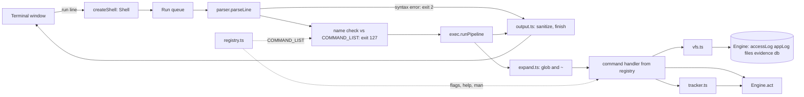
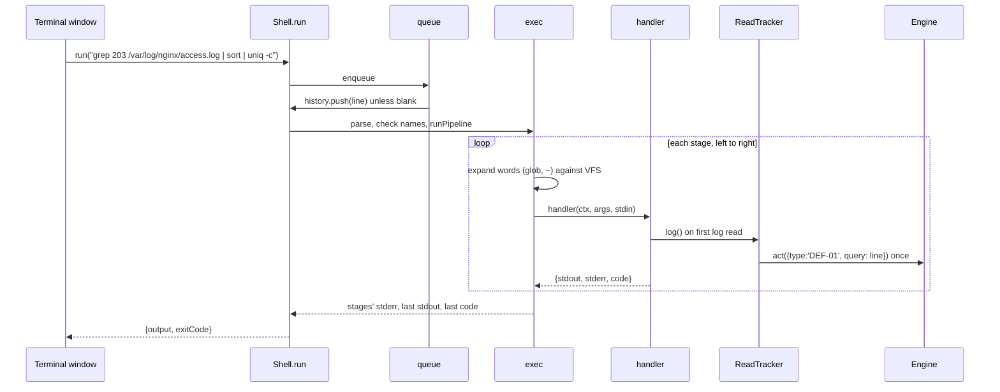
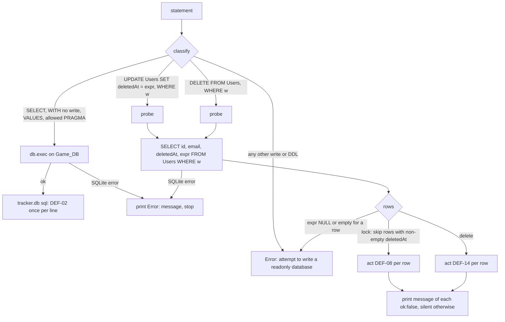

# Design Document

## Overview

This document designs PRD row SYS-09, the game's emulated terminal, in `game/src/shell/`. It implements `.kiro/specs/shell/requirements.md` (R1 to R16) and is grounded in the code that exists today: `game/src/engine/engine.ts`, `actions.ts`, `state.ts`, `sqldb.ts`, `replay.ts`, `log.ts`, `clock.ts`, `game/src/rules/vocabulary.ts` (`PlayerAction`), `docs/ENGINE_API.md` §5, `docs/DECISIONS.md` (D-22, D-90 to D-109), `docs/KNOWN_ISSUES.md` (KI-90, KI-91), `docs/PRD.md` (SYS-09) and `.kiro/steering/game-shell.md`.

The Shell is a pure TypeScript module with no UI and no network. It takes one command line at a time, parses it, checks every command name, runs the pipeline against a virtual file system built over the Engine, and resolves to plain text. It changes the incident only through `Engine.act`.

Design in one paragraph: `createShell(engine)` returns `{ run, complete? }`. `run` is serialized through a promise queue, so two lines never interleave. A line goes through `parse` (a pure function that keeps globs and `~` unexpanded), a name check (127), then a left-to-right pipeline executor. Each stage expands its words against the Virtual_FS, looks up its entry in the **registry** (the single source of flags, help and man text), parses its flags with the registry data, and runs a handler. Handlers read through the VFS and a per-line `ReadTracker`, which sends DEF-01, DEF-02 and DEF-03 at most once each per line. Handlers that change the incident follow plan-then-commit: validate everything, build the output, and only then call `Engine.act`. A catch-all around each stage guarantees `run` never rejects (R15.4).

Libraries: the project already has Vitest 4.1.12, fast-check 4.10.3 and sql.js 1.16.0 in `game/package.json`. **This design adds no dependency.** SHA-256 is a small in-house synchronous function (see Design decisions), tested against `node:crypto` in the test suite.

### Design decisions summary

| Decision | Choice | Why |
|---|---|---|
| Shell state | One `Session` object per `createShell`, holding cwd, history, run counter and the Virtual_FS overlay. No module-level state | Two shells never share state; tests build as many as they like |
| Concurrency | `run` calls are chained on one promise queue | `sqlite3` awaits `Engine.db()`; without a queue two lines could interleave and corrupt cwd, history and the read tracker |
| Byte vs text | VFS files are `Uint8Array`; pipes carry `string` | `cp`, `tar` and `sha256sum` must be byte-exact (R4.11, R8.7); text commands decode as UTF-8 |
| Command data | One `CommandSpec` per command in `registry.ts` (flags, summary, examples, handler). `help`, `man`, flag validation and `COMMAND_LIST` are all derived from it | R12.10 and R2.1 by construction |
| SHA-256 | In-house sync implementation in `sha256.ts` (about 50 lines), property-tested against `node:crypto` | `crypto.subtle` is async and exists only in secure contexts in browsers; a sync function keeps VFS code simple. Not a project decision, no D entry |
| Writes to the world | Only `Engine.act`. The Shell sees the world as `DeepReadonly<World>` (compile-time) | R14.1 enforced by the type checker and by a test |
| Stdout and stderr | A command returns `{ stdout, stderr, code }`; `run` shows the stderr of every stage first, then the stdout of the last stage | Matches a real terminal; an error in stage 1 never travels down the pipe |
| Trailing newline | Streams keep their final `\n` internally; `run` removes one final `\n` from the displayed output | `wc -l` needs the newline, the terminal window should not print a blank last line |
| Failed read notice | If DEF-01/02/03 returns `ok: false` (only after an ending), the read still prints, one `<cmd>: <message>` line is added, the exit code is unchanged | R14.6 asks for an error message and no retry; the data read is harmless |

## Gaps in the Engine

The requirements assume `Engine.files()`, `evidence()`, `db()`, `accessLog()`, `appLog()` and `act`. All of them exist, but several have a different shape from what the requirements assume. Nothing below is invented; each row says what the code really does and what the design does about it. Items marked **Decision** became a `D-1xx` entry in `docs/DECISIONS.md` (see Decisions D-100 to D-109).

| # | Requirement assumes | What the Engine really has | Design response |
|---|---|---|---|
| G1 | `Engine.files()` returns paths in `uploads/` (R4.4, R6.2) | Returns `VFile[]` (`{ path, size, sha256, contentBase64?, plantedBy? }`), a **copy** per call. `path` is **relative to `uploads/`** (for example `complaints/rip.php`). There are no directory entries, no times, no modes. `contentBase64` is optional | The VFS derives directories from path prefixes, prepends `/srv/juice-shop/uploads/`, decodes base64 to bytes. `ls -l` prints no times (R5.3 asks for none). If `contentBase64` is absent, the file lists with `size`, `sha256sum` prints `VFile.sha256`, and reading its bytes fails with `Input/output error` (part of D-100) |
| G2 | `rm <path>` sends `{ type: 'DEF-15', path }` with the **absolute** path (R11.1) | `applyAction` does `world.files.find((x) => x.path === action.path)`. Every engine test, the sims and ENGINE_API use the path **relative to `uploads/`**. An absolute path always answers `No such file: ...` | **Decision D-100.** The Shell strips `/srv/juice-shop/uploads/` and sends the relative path. R11.1 and R11.5 need the wording change |
| G3 | `Engine.evidence()` lists snapshot "names" as `ls /evidence` entries (R4.5) | Returns `Evidence[]` (`{ name, takenAt, accessLines, appLines }`). It has **no content** and `name` has **no `.tgz`** (DEF-05 stores the `name` it was given) | The Shell lists `<name>.tgz` for each entry. Content for archives the Shell made is kept in the Shell. For evidence made elsewhere (the Easy console) the Shell synthesizes content from the first `accessLines` and `appLines` lines of the logs (the logs only grow, so that prefix is exactly the snapshot). **Decision D-101** |
| G4 | `Engine.db()` gives the Game_DB (R7) | Returns `Promise<GameDb>` with `{ db: Database, applied, seedUsers }`, not a `Database`. It calls `syncDb` on every call. It **throws inside an async function**, so it rejects, when no `baseline` was given. There is no byte access to the database file except `g.db.export()`, which in sql.js closes and re-opens the database and resets pragmas | The Shell always uses `(await engine.db()).db`, never caches it across statements or lines, never runs a write on it. File-style reads of the `.sqlite` file call `export()` lazily (`ls -l` size, `tar`, `cp`, `sha256sum`, `file`). **Decision D-102** |
| G5 | Game-time-limited log text (R6.1) | `accessLog()` and `appLog()` return the **whole** log so far, rendered fresh on each call. There is no time parameter | None needed, and none invented. `replay.ts` appends a line only when `startedAt + e.t * ratio <= now`, so every line in `world.logs` already has `t <= clock.gameMs`, and an empty log renders `''`. The Shell reads the text as is. A test asserts that no rendered nginx line has a timestamp after `gameTimeIso(world)`. Note that `AppLine` has **no time** in its text (R6.1 "recorded time" holds by construction for app lines) |
| G6 | `sqlite3` sees the lock, R7.3 | `syncDb` writes `deletedAt = datetime('now')` using the **real clock** of the machine | The Shell cannot fix this. Outputs that show `deletedAt` of a locked account differ between runs. Determinism tests (R15.6, R15.7) never print a locked account's `deletedAt`. Logged as **KI-91** in `docs/KNOWN_ISSUES.md` (the Engine should stamp game time) |
| G7 | `act` may fail or be rejected (R14.6) | `act` returns `ActionResult { ok, message }` and by design never throws. After applying the action it calls `advance(world, library, 0)`, which could throw on a bug. After `world.ending` every action answers `ok: false` with `The incident is over: <ending>` | `ok: false` is printed as is (R7.10, R9.4, R10.7, R11.5). A thrown error is caught by the stage catch-all. The Shell cannot roll back; **R15.4's "World deeply equal to before" holds for errors raised before the first `act` of the command**, which plan-then-commit makes the only place a Shell bug can occur (see Error Handling) |
| G8 | One IPv4 rule shared by Shell and Engine (R6.8, R9.1, R9.2) | `IPV4` in `actions.ts` is a private constant. It rejects leading zeros (`01.2.3.4`) | The Shell has its own `isIPv4` with the same grammar. A property test checks it against the Engine: for random strings, `isIPv4(s)` equals "DEF-06 add does not answer `... is not an IPv4 address`" |
| G9 | The Shell can tell whether a lock or delete is a real account | Nothing. `DEF-08` and `DEF-14` look up `world.accounts` by email; the DB can hold rows the world does not (non-seed accounts before their insert replays) | Print the action's `message` and go on (R7.10) |
| G10 | `UPDATE Users SET deletedAt = NULL` could mirror an unlock | No action unlocks an account. `syncDb` only re-NULLs `deletedAt` after DEF-17 restores a backup | The Shell treats an UPDATE whose `deletedAt` value evaluates to NULL or `''` as a read-only error (part of D-103) |
| G11 | The Shell must not change the World (R14.1) | `engine.world` is a plain mutable `World` | `shell/` imports `World` only through a `DeepReadonly<World>` alias in `types.ts`. A test deep-clones the world around read-only lines |
| G12 | `date` shows game time (R12.1) | `clock.ts` exports `gameTimeIso(world)` (pure; start time from `CONFIG[difficulty].scenarioStartIso` plus `clock.gameMs`) | `date` imports `gameTimeIso`. It reads no real clock |
| G13 | `Engine.difficulty` | There is none. The difficulty is `engine.world.difficulty` (`'easy' \| 'medium' \| 'hard'`) | `createShell` reads it once, at construction, to decide whether `complete` exists |
| G14 | Evidence names and archive paths line up | DEF-05 rejects only a **duplicate name**. It accepts any string (no charset check) | The Shell validates `<name>` (R8.1, R8.10) before calling `act` |
| G15 | The access log is about as large as the recorded attack (earlier design assumption) | Customers (SYS-19, D-65, PR #79) write `by: 'CUST'` lines into `world.logs.access`: about 3,000 requests per recorded 10-minute loop, so the access log is far larger than the earlier design assumed. `renderAccessLog` re-renders the **whole** log on every `accessLog()` call | The Shell reads the log text **once per command invocation**, not once per line or per pipeline stage that needs it (a handler calls `vfs.readBytes` once and splits the text). Tests that count or compare log lines allow for customer lines (they filter by the attack's IP or compare against `engine.accessLog()`, never against a fixed line count). A performance check runs `grep` over a whole-run log (the loop played to its end) and asserts it finishes well inside the 5,000 ms bound of R15.1 |
| G16 | `World` has the fields the earlier design knew | `World` gained `customers`, `tickets` and `heartbeatMax` | The Shell never reads or writes them. The `DeepReadonly<World>` alias in `types.ts` follows the type, so no change is needed |

**Re-check after the rebase on origin/main (PR #79).** G1 to G14 were checked again against the rebased code and still hold: `files()`, `evidence()`, `db()`, `accessLog()` and `appLog()` are unchanged; `actions.ts`, `sqldb.ts` and `clock.ts` are unchanged; DEF-15 still matches the path relative to `uploads/`; every access line, customers' lines included, is pushed only when due, so `t <= gameMs` holds for every rendered line (G5).

## Decisions D-100 to D-109 (accepted, recorded in docs/DECISIONS.md)

The team accepted each decision below as written, and each has an entry in `docs/DECISIONS.md`. This design is written on them. The column "Touches" lists the sections each decision shapes. They use the whole reserved range.

| ID | Question | Decision | Touches |
|---|---|---|---|
| D-100 | DEF-15's `path` is relative to `uploads/` in the Engine, but R11.1 says absolute | The Shell sends the path **relative to `/srv/juice-shop/uploads/`**, for example `complaints/rip.php`. R11.1 and R11.5 were reworded (absolute path in the Shell, relative in the action). DEF-03 keeps the **absolute** path (R14.5), because the Engine only logs it. A file whose `contentBase64` is absent lists with its size, prints `VFile.sha256` for `sha256sum`, and fails with `Input/output error` when its bytes are read | `commands/filesys.ts`, `vfs.ts`, tests for R11 |
| D-101 | Evidence naming and mutability. The Engine stores `<name>` while the file is `<name>.tgz`; `rm` of an evidence file would leave the Engine's record in place | `/evidence/<name>.tgz` is the only archive form under `/evidence` (nested paths and other extensions are an invalid archive name, R8.10). Every Engine evidence entry shows as `<name>.tgz` and is **immutable**: `rm`, `cp` onto it and `>` onto it print `Operation not permitted`. Evidence made by the Easy console (no Shell archive) is listed, readable and hashable with synthesized content (log prefixes), but `tar tzf` on it reports "not an archive the Shell created" (R8.9) | `vfs.ts`, `commands/archive.ts`, `commands/filesys.ts` |
| D-102 | The database file as a file. Requirements list it in the VFS but not what `cat`, `cp`, `tar`, `sha256sum` and `ls -l` do with it | It is a normal read-only file whose bytes are `(await engine.db()).db.export()` taken on demand. The raw reads are untracked (no DEF-02, since DEF-02 is for SQL), except that `cat`, `head`, `tail`, `grep` on it print the bytes decoded and sanitized (D-106). `rm`, `cp` onto it, `>` onto it: `Permission denied` | `vfs.ts`, `commands/database.ts` |
| D-103 | SQL execution rules R7 leaves open | (1) The argument is split on `;` outside quotes and parentheses, statements run in order, **the first error stops the rest** (what `sqlite3_exec` does). (2) Read statements allowed: `SELECT`, `WITH` without a write keyword, `VALUES`, and `PRAGMA table_info\|table_xinfo\|index_list\|foreign_key_list\|database_list`. (3) A write is recognised only in the forms `UPDATE Users SET deletedAt = <expr> [WHERE <w>]` and `DELETE FROM Users [WHERE <w>]`; `OR`, `RETURNING`, `ORDER BY`, `LIMIT`, `FROM`, a second assigned column or an alias are read-only errors. (4) The `<expr>` is evaluated in the probe; if it yields NULL or `''` for a matched row, the statement is a read-only error (no unlock exists, G10). (5) Messages: `Error: attempt to write a readonly database` for refused writes, `Error: <SQLite message>` for invalid SQL, `Error: database is unavailable` when `Engine.db()` rejects | `commands/database.ts`, `sqlprobe.ts` |
| D-104 | Quoting grammar beyond R3 | No backslash escapes anywhere. Inside single and double quotes every character is literal, including `$` (R3.7 forbids `$` only outside quotes). Adjacent quoted and unquoted pieces join into one word (`a"b c"d` is one word). A word that was quoted anywhere is never glob-expanded. A redirect target gets `~` expansion only, no glob. Outside quotes `&`, `(`, `)` and a lone `$` are syntax errors | `parser.ts`, `printer.ts`, `expand.ts` |
| D-105 | Regex dialect for `grep` and `awk`, and a guard against catastrophic patterns | `grep` without `-E` is a basic regex: `. * ^ $ [ ]` are special and `+ ? \| ( ) { }` are literal. With `-E`, and in `awk /re/`, they are special (ERE written as a JavaScript `RegExp`). A pattern is rejected (`grep: unsupported pattern`) if it exceeds 256 characters, uses a back-reference, quantifies a group that itself contains a quantifier (`(a+)+`), or has a counted repeat above 255. This keeps `run` inside the 5,000 ms bound of R15.1 without a timer | `regex.ts` |
| D-106 | R1.4: "no HTML tags and no ANSI escape sequences" cannot hold for echoed arguments or file content (`cat '<b>'` prints `<b>` in an error; an uploaded file may contain `<script>`) | The Shell **adds no markup** and neutralizes control characters: every character below U+0020 except `\n` and `\t`, and U+007F, is shown as caret notation (`^[` for ESC, `^@` for NUL), as `cat -v` does. File content and echoed text are **not** altered otherwise. The terminal window must render `output` as text, never as HTML. The R1.4 property test checks the control-character rule and that Shell-generated lines hold no `<` | `output.ts`, terminal window (SCENES) |
| D-107 | Flags for commands whose requirements list none (`ping`, `nmap`, `curl`, `whois`, `ss`, `cp`, `mkdir`, `date`, `history`, `help`, `file`, `sha256sum`, `rm`) | `ping -c <count>` (default 4, 1 to 20); `nmap -p <ports>` and `-sV`; `curl -I` and `-s`; `ss -t -l -n` and bundles; `rm -r` only (no `-f`, no `-R`); `mkdir -p`; `cp` none; `whois`, `date`, `history`, `help`, `file`, `sha256sum` none. Any other flag is the unsupported-flag error of R5.19. R16.1 then has a defined flag list for each command (the registry) | `registry.ts`, `commands/network.ts` |
| D-108 | `rm -r` on a directory inside `uploads/`, and `rm` with several operands | `rm -r <dir in uploads>` sends one `DEF-15` per file beneath it, in ascending path order, and continues after a refusal. `rm` with several operands (including a glob) handles them left to right, one action per Uploaded_File, and ends with exit code 1 if any operand failed. The directory entry disappears by itself when its last file is removed | `commands/filesys.ts` |
| D-109 | What an archive is, and what `tar tzf` and `file` show | An archive is a deterministic byte string: gzip magic `1f 8b 08 00`, then a canonical listing of entries (`path`, type, length, bytes), not real compression. `sha256sum` hashes those bytes. `tar tzf` prints each source path in the order given, each followed by its descendants in ascending order, directories with a trailing `/`, leading `/` removed, as real tar does. `file` reports `gzip compressed data`. A missing source reads `tar: <path>: No such file or directory` (R8.3 gives both phrases) | `commands/archive.ts`, `vfs.ts` |

## Architecture

### Module layout

```
game/src/shell/
  index.ts            exports: COMMAND_LIST, checkCommandLine, createShell, types Shell/RunResult
  types.ts            Shell, RunResult, Word, Stage, Pipeline, CommandSpec, CommandContext, CommandResult, DeepReadonly
  parser.ts           parseLine(line): ParseResult            (pure, no Engine)
  printer.ts          printLine(pipeline): string             (pure)
  expand.ts           expandWord, globMatch, tilde            (needs a read-only VFS lister)
  path.ts             resolvePath, dirname, basename, byteCompare   (pure)
  vfs.ts              VirtualFs: stat/list/read/write over Engine + overlay
  archive-format.ts   encodeArchive / decodeArchive / listArchive  (pure, deterministic)
  session.ts          Session: cwd, history, runCount, overlay, createSession(engine)
  tracker.ts          ReadTracker: DEF-01/02/03 once per kind per line
  registry.ts         COMMAND_NAMES, COMMANDS (CommandSpec per name), single source for flags/help/man
  argparse.ts         parseArgs(spec, argv), parseForms(forms, argv)
  exec.ts             runPipeline(ctx, pipeline, rawLine)
  output.ts           sanitize, errLine, finish (strip one trailing newline), message catalog
  regex.ts            compilePattern(dialect, source, flags): RegExp | error     (ReDoS guard, D-105)
  sha256.ts           sha256Hex(bytes): string                                    (sync)
  text.ts             splitLines, joinLines, decodeUtf8, encodeUtf8, compareCodePoints
  complete.ts         complete(session, vfs, partial): string[]
  sqlprobe.ts         splitStatements, classifyStatement, parseWrite, buildProbe   (pure)
  netdata.ts          whoisFor, pingLines, nmapLines, curlLines, ssLines           (pure, deterministic)
  commands/
    navigation.ts     ls cd pwd
    textproc.ts       cat head tail grep awk sort uniq wc cut
    filesys.ts        file sha256sum cp rm mkdir
    archive.ts        tar
    database.ts       sqlite3
    network.ts        whois ping nmap curl ss
    ops.ts            iptables systemctl
    session-cmds.ts   date history clear help man
  test-fixtures/
    fixture.ts        makeFixture(): Engine + Shell + spies (see Testing Strategy)
    generators.ts     fast-check arbitraries
  *.test.ts           colocated tests (see Testing Strategy)
```

`game/src/shell/` imports from the engine only: `Engine` (type), `ActionResult`, `PlayerAction` (from `../rules/vocabulary`), `World` and `VFile`/`Evidence` (types from `../engine/state`), `gameTimeIso` (from `../engine/clock`) and `eventsOfKind` (tests only). It never imports `applyAction`, `advance` or any mutator, and nothing in `engine/` imports `shell/`.

### Component and data flow



### Sequence of one line



### Interfaces to the Engine (the only calls the Shell makes)

| Engine member (real signature) | Used by |
|---|---|
| `act(action: PlayerAction): ActionResult` | tracker (DEF-01/02/03), whois/ping/nmap/curl (DEF-04), tar (DEF-05), iptables (DEF-06), sqlite3 (DEF-08, DEF-14), systemctl (DEF-11, DEF-18), rm (DEF-15) |
| `accessLog(): string`, `appLog(): string` | `vfs.ts` (log files) |
| `files(): VFile[]` | `vfs.ts` (uploads), `rm` |
| `evidence(): Evidence[]` | `vfs.ts` (/evidence), `tar` duplicate pre-check is not possible (G14), so it relies on `act` |
| `db(): Promise<GameDb>` | `commands/database.ts`, `vfs.ts` (file bytes via `export()`) |
| `world` (read only) | `iptables -L` (`firewall.blocked`), `systemctl status` and `ss` (`nginx`), `date` (`clock.gameMs`, difficulty), `createShell` (`difficulty`) |

The Shell never calls `advance`, `pause`, `resume`, `subscribe` or writes `world.clock` (R14.2).

## Components and Interfaces

### Public surface (`index.ts`, `types.ts`)

```ts
export interface RunResult { output: string; exitCode?: number; clear?: true }

export interface Shell {
  run(line: string): Promise<RunResult>;
  complete?(partial: string): string[];   // present only when engine.world.difficulty === 'easy' (D-94)
}

export const COMMAND_LIST: readonly CommandName[];          // exactly the 31 names, in the steering order
export function checkCommandLine(line: string): boolean;    // R2.2, R2.3: pure, no Engine
export function createShell(engine: Engine): Shell;
```

- `run` always resolves with `exitCode` set (0, 1, 2 or 127). D-95 allows omitting 0; always setting it keeps screens simple. For `clear` the result is `{ output: '', exitCode: 0, clear: true }`, which is R12.4 plus an explicit `exitCode`; tests use `toMatchObject`.
- `complete` is added with a conditional spread, so on Medium and Hard `shell.complete === undefined` and `'complete' in shell` is false (R1.7).
- `checkCommandLine` runs `parseLine` and then checks the command name of every stage against `COMMAND_LIST`. It returns `false` for a parse error, for any unknown name, and never throws (a `try/catch` returns `false`). It does not need an Engine, so Kiro's server-side guard (KIRO-08) can import it.
- `COMMAND_LIST` is `COMMAND_NAMES` from `registry.ts`: a `const` tuple written in the steering order, with `COMMANDS satisfies Record<CommandName, CommandSpec>` so the compiler rejects a missing or extra command.

### Parser (`parser.ts`) and Pretty_Printer (`printer.ts`)

```ts
export interface Word { text: string; literal: boolean }        // literal: quoted in the source AND (contains '*' or starts with '~')
export interface Redirect { target: Word }
export interface Stage { name: Word; args: Word[] }
export interface Pipeline { stages: Stage[]; redirect?: Redirect }

export type ParseResult = { ok: true; pipeline: Pipeline } | { ok: false; error: string };
export function parseLine(line: string): ParseResult;
export function printLine(p: Pipeline): string;
```

The lexer is one pass over characters with three modes: unquoted, single-quoted, double-quoted (D-104). Rules:

- Whitespace outside quotes ends a word. `|` ends a word and a stage. `>` starts the redirect target, which must be exactly one word and the last thing on the line.
- Quoted and unquoted pieces that touch join into one word. The word's `literal` flag is `quotedAnywhere && (text.includes('*') || text.startsWith('~'))`. Computing it this way (rather than storing "was quoted") is what makes the round trip hold: quotes that carry no meaning are dropped by the printer, and re-parsing yields the same structure.
- Syntax errors (exit code 2, no command runs, R3.6, R3.7, R2.7): unterminated quote; leading, trailing or doubled `|`; `>` with no target or with extra words after the target; `;`, `&`, `&&`, `||` (which is an empty stage), `>>`, `<`, `2>`, `$` outside quotes, a backtick outside quotes, `(` and `)` outside quotes. The messages are fixed strings, for example `sh: syntax error: unterminated quote`.
- Globs and `~` are left in `Word.text` untouched (R3.13). An empty line parses to `{ stages: [] }` and is handled by `run` before parsing (R1.5).

The printer (R3.8) writes a word unquoted only if it is non-empty, not `literal`, and either made only of characters from the safe set `A-Z a-z 0-9 _ @ % + = : , . / ~ * -`, or a word containing `*` or starting with `~` that holds no whitespace and none of `| > & ; < $ ` ( ) ' "`. Otherwise it wraps the word in single quotes and writes each embedded `'` as `"'"` (so `a'b` prints `'a'"'"'b'`). Stages are joined with ` | `, the redirect is ` > <target>`.

Round trip (R3.9): for every `Pipeline` produced by the generator, `parseLine(printLine(p))` equals `{ ok: true, pipeline: p }`, and for every string `s` that parses, `parseLine(printLine(parse(s)))` equals `parse(s)`. The generator constrains `literal: false` words to the safe set, or to a word with `*` or a leading `~` free of whitespace and of `| > & ; < $ ` ( ) ' "`, so those words never need quotes.

### Expansion (`expand.ts`)

```ts
export function expandWord(w: Word, session: SessionView, vfs: VfsLister): string[];
export function expandTilde(text: string): string;                 // '~' or '~/x' -> '/srv/juice-shop' + rest
export function globExpand(pattern: string, cwd: string, vfs: VfsLister): string[];
```

- Runs at execution time, per stage, immediately before the stage's handler (D-93). `Word.literal` words skip expansion; so do words with no `*` (they still get tilde expansion when unquoted and equal to `~` or starting with `~/`; a quoted `~` is `literal` and stays).
- `globExpand` splits the pattern on `/`, then walks the VFS one segment at a time. A segment with `*` is turned into a matcher in which `*` is any run of characters other than `/`. A segment matches a name beginning with `.` only if the segment itself begins with `.`. Results keep the prefix form the player typed (relative stays relative). The final list is sorted with `compareCodePoints` (same order as UTF-8 bytes) and is `[w.text]` when empty (R3.10).
- The command name word and the redirect target are never glob-expanded (D-104). Redirect targets get `~` expansion.
- Listing for globs goes through `VfsLister.list(abs)`, which is the VFS's own sync directory listing. Listing for a glob **does not** count as a read of `uploads/` (only `ls`, `cat`, `file`, `sha256sum`, `head`, `tail`, `grep` and friends on `uploads/` do, see Read tracking).

### Virtual file system (`vfs.ts`, `path.ts`, `archive-format.ts`)

```ts
export type Area = 'system' | 'log-access' | 'log-app' | 'db' | 'uploads' | 'tmp' | 'evidence';
export interface Stat { kind: 'dir' | 'file'; area: Area; readonly: boolean }

export class VirtualFs {
  constructor(engine: Engine, overlay: Overlay);
  // sync, names only: safe for glob, cd and complete
  stat(abs: string): Stat | undefined;
  list(abs: string): string[] | undefined;                 // sorted with compareCodePoints, no '.' or '..'
  areaOf(abs: string): Area;
  canWrite(abs: string): boolean;                          // under /tmp or /evidence, and not Engine evidence
  // async: bytes can need Engine.db()
  size(abs: string): Promise<number>;
  readBytes(abs: string): Promise<Uint8Array>;             // throws FsError
  // writes (overlay only; throw FsError)
  writeFile(abs: string, bytes: Uint8Array): void;
  mkdir(abs: string, opts?: { parents?: boolean }): void;
  copy(srcAbs: string, dstAbs: string): Promise<void>;
  remove(abs: string, opts?: { recursive?: boolean }): void;
  putArchive(abs: string, a: ArchiveEntry[]): void;
}

export class FsError extends Error { code: 'ENOENT' | 'EACCES' | 'EISDIR' | 'ENOTDIR' | 'EEXIST' | 'EPERM' | 'EIO' }
```

The tree has three layers.

1. **Skeleton** (static directories): `/`, `/var`, `/var/log`, `/var/log/nginx`, `/var/log/juice-shop`, `/srv`, `/srv/juice-shop`, `/srv/juice-shop/data`, `/srv/juice-shop/uploads`, `/tmp`, `/evidence`. These exist from construction (R4.1). Nothing else exists, so `cd /etc` fails with `No such file or directory`.
2. **Live files**, computed on every call and never cached, so a read always shows the Engine as it is now (R4.2, R4.3, R4.4, R11.7):
   - `/var/log/nginx/access.log` = UTF-8 of `engine.accessLog()`; `/var/log/juice-shop/app.log` = UTF-8 of `engine.appLog()`.
   - `/srv/juice-shop/data/juiceshop.sqlite` = `export()` bytes (D-102).
   - Uploads: from `engine.files()`; each `VFile.path` is split on `/`; the parent segments become directories, the last segment a file whose bytes are `decodeBase64(contentBase64)`.
   - `/evidence`: names `<name>.tgz` from `engine.evidence()`.
3. **Overlay** (`Overlay`, kept in the `Session`): a `Map<string, OverlayNode>` for files and directories the player made under `/tmp` and `/evidence`. A node is `{ kind: 'dir' }`, `{ kind: 'file', bytes }` or `{ kind: 'archive', entries, bytes }`.

`list('/evidence')` is the union of the overlay's names there and the `<name>.tgz` of every Engine evidence entry, de-duplicated (R4.5). If both exist for one name, the overlay node's content is used unless the Engine entry was not created by the Shell (D-101: then the synthesized content is used).

**Write boundaries** (R3.3, R4.10 to R4.14, R11.6, D-90, D-101): `canWrite(abs)` is true only for `/tmp`, `/evidence` and paths below them, and false for an Engine evidence file. `writeFile`, `mkdir`, `copy` (destination), `putArchive` and redirection targets throw `FsError('EACCES')` outside that area, including everything in `uploads/`. `remove` on `uploads/` is never a VFS operation: `rm` calls `Engine.act` instead (D-100). Logs and the database file are never writable or removable.

**Path handling** (`path.ts`): `resolvePath(cwd, input)` joins, collapses `.` and `..` (`..` at `/` stays at `/`, R4.9), and removes trailing `/`. `byteCompare` is `compareCodePoints`. Error messages quote the path **as typed** (R4.8).

**Archives** (`archive-format.ts`, D-109). `ArchiveEntry = { path: string; type: 'file' | 'dir'; bytes: Uint8Array }`. `encodeArchive(entries)` produces `1f 8b 08 00`, then for each entry a length-prefixed canonical record. It is deterministic and not compressed. `sha256sum` hashes those bytes, so the digest is identical across calls (R8.7) and differs when any archived byte or path differs. `listArchive(bytes)` returns the paths for `tar tzf`. Sources are copied (frozen) at creation: a later change to a log or an upload does not change an existing archive.

### Session and run queue (`session.ts`, `index.ts`)

```ts
interface Session {
  cwd: string;                    // starts '/srv/juice-shop' (D-94)
  history: string[];              // at most 500 most recent lines
  runCount: number;               // lines ever entered; numbering continues past 500 (R12.3)
  overlay: Overlay;
}
```

`createShell` builds the session, a `VirtualFs`, and a promise chain: `run(line)` does `chain = chain.then(() => runOne(line), () => runOne(line))` and returns the promise for this line. `runOne` is wrapped in `try/catch` so the chain itself never rejects. `history` stores the line **unmodified** (R1.6) before parsing, so syntax errors, unknown commands and failures are all kept (R1.9), and a whitespace-only line is neither stored nor counted (R1.5). `history` numbering for entry `i` of `n` stored lines is `runCount - n + 1 + i`.

### Pipeline executor (`exec.ts`)

```ts
export interface CommandResult { stdout: string; stderr: string; code: number; clear?: true }
export type Handler = (ctx: CommandContext, args: string[], stdin: string) => CommandResult | Promise<CommandResult>;

export interface CommandContext {
  engine: Engine;                 // act, db, accessLog ... (read-only members used through vfs where possible)
  world: DeepReadonly<World>;
  vfs: VirtualFs;
  session: Session;
  reads: ReadTracker;             // one per run call
  name: CommandName;
  spec: CommandSpec;
}

export async function runPipeline(sh: ShellInternals, pipeline: Pipeline, rawLine: string): Promise<RunResult>;
```

Algorithm (R3.1, R3.2):

1. Names: if any stage's name is not in `COMMAND_LIST`, return `<name>: command not found` for the **first** unknown stage with exit code 127, run nothing, call no action (R1.8, R2.4, R2.7, R15.3). A syntax error is detected earlier and wins with exit code 2.
2. For each stage left to right: expand `args` with `expandWord`; call `parseArgs(spec, args)`; on an unsupported flag return the R5.19 error without running the handler; otherwise run the handler inside `try/catch` (see Error Handling) with `stdin` = the previous stage's stdout (`''` for stage 1: a command with no file operand and no pipe sees end of input at once, as in a script).
3. Collect each stage's `stderr`. `stdout` flows to the next stage. The exit code of the line is the last stage's code. The `clear` flag is honored only for a single-stage line whose handler set it.
4. Redirect: if `redirect` is present and **every stage's code is 0**, write the last `stdout` (UTF-8) to the target with `vfs.writeFile` and return an empty stdout; a target that is outside the writable area gives `Permission denied`, a directory or a missing parent gives the R3.4 error, and in both cases nothing is written. If a stage failed, the file is not written (R3.2) and the stderr is shown. (Consequence: `grep x log > /tmp/o` with no match writes nothing, because `grep` exits 1. This follows R3.2 literally.)
5. `output` = stderr of stages in order, then the last stdout (empty when redirected), passed through `sanitize` (D-106) and `finish` (drop one final `\n`).

`awk`, `grep`, `sort`, `uniq`, `wc`, `cut`, `head`, `tail`, `cat` and `sha256sum` take `stdin` when no file operand is given. Others ignore it.

### Registry (`registry.ts`, `argparse.ts`) and R12.10

```ts
export interface FlagSpec {
  name: string;                       // '-l', '-n', '-F', '-header'
  summary: string;                    // one line, shown by man
  value?: 'attached' | 'separate' | 'either';   // takes an argument; '-F:' or '-F :' for awk
  valueName?: string;                 // for man: '<count>'
}
export interface CommandSpec {
  name: CommandName;
  summary: string;                    // <= 80 chars, shown by help (R12.5)
  usage: string;                      // shown by man and by usage errors
  flags: FlagSpec[];                  // the ONLY list validation uses
  forms?: string[];                   // for grammar commands: iptables, systemctl, tar, sqlite3, awk
  examples: string[];                 // at least one (R12.6)
  operands: { min: number; max: number };
  numericCount?: boolean;             // head and tail accept -<count>
  readsStdin: boolean;
  handler: Handler;
}
export const COMMAND_NAMES: readonly [...31 names in steering order];
export const COMMANDS: Record<CommandName, CommandSpec>;
```

- `parseArgs(spec, argv)` accepts bundled short flags (`-la`), a multi-letter flag only when the whole token equals a `flags` name (`-header`), attached or separate values per `FlagSpec.value`, `--` to end flags, and `-<digits>` when `numericCount` is set. It returns `{ flags, operands }` or `{ error: 'unsupported flag -z' }`. The error line is `<cmd>: unsupported flag '<flag>'` with a usage hint and exit code 1, and nothing else is printed (R5.19, R12.9).
- Grammar commands (`iptables`, `systemctl`, `tar`, `sqlite3`, `awk`) declare `forms` such as `-A INPUT -s <ip> -j DROP`, `-D INPUT -s <ip> -j DROP`, `-L`, or `<status|stop|start|restart> <unit>`. `parseForms(forms, argv)` is a small matcher whose placeholders are `<ip>`, `<name>`, `<unit>`, `<path>`, `<sql>`, `<count>`. The handlers get the matched form and its captured values, so the text that `man` prints and the grammar the handler accepts come from the same strings.
- `help` prints, for each name in `COMMAND_NAMES` sorted by `compareCodePoints`, `<name>  <summary>`. `man <command>` prints NAME, USAGE, one line per `flags` entry (or per `forms` entry), and `examples`. Both read only `COMMANDS`. A test (Property 15) scans the `man` text for flag-looking tokens and checks that each is in `flags`.

### Read tracking (`tracker.ts`) and DEF-01/02/03 (R14.4, R14.5, R14.7, D-98)

```ts
export class ReadTracker {
  constructor(engine: Engine, line: string);
  log(): string | undefined;                  // DEF-01 { query: line }; returns a notice when act answered ok:false
  db(sql: string): string | undefined;        // DEF-02 { sql }
  uploads(absPath: string): string | undefined;   // DEF-03 { path: absolute }
  readonly sent: ReadonlySet<'log' | 'db' | 'uploads'>;
}
```

One tracker is created per `run` call with the raw line. Each method marks its kind as sent **before** it calls `act`, so a kind is never sent twice even when `act` is refused. The VFS read paths take an optional `ReadSink`; handlers pass `ctx.reads` for content reads and `untracked` for the cases below.

| Operation | Kind | When it fires |
|---|---|---|
| `cat head tail grep awk sort uniq wc cut file sha256sum cp` reading a log file's content | DEF-01 | first log read in the line, at read time |
| `ls` on `/var/log/...` | none | listing names and sizes is not reading content |
| `ls`, `cat head tail grep file sha256sum cp` on a path at or below `/srv/juice-shop/uploads` | DEF-03 with the first such absolute path | first uploads read in the line |
| `glob` expansion, `cd`, `rm`, `complete`, `mkdir` | none | names only |
| `sqlite3` SELECT (first one that succeeds), `.tables`, `.schema` | DEF-02 with the first read statement's text (the dot-command text for `.tables`) | after the statement ran without error |
| the internal WHERE-clause probe of an UPDATE or DELETE | none (R7.5) | uses `readRaw`, not the tracker |
| `tar czf` source reads | none (R14.7) | tar reads through `readBytes` with no sink and sends DEF-05 only |
| stdin data | none | data came from an earlier stage and was tracked there |

`cp` from a log or from `uploads/` reads through the tracker, so it sends DEF-01 or DEF-03 (R14.7). A line that fails before reading (unknown command, bad flag, missing operand) never reaches a read, so it sends nothing (R14.7). Because the tracker is consulted at read time, a pipeline of two log readers sends one DEF-01, and `grep x log | cat uploads/f` style lines send one DEF-01 and one DEF-03 (R16.2).

A tracker notice (the `message` of an `ok: false` answer, possible only after an ending, G7) is appended to the current stage's stderr as `<cmd>: <message>`.

### Command groups

Each file exports a `Handler` per command, registered in `registry.ts`. Common helpers in `output.ts`: `ok(stdout)`, `fail(cmd, message, code = 1)`, `usage(spec)`, `notFound(cmd, typedPath)`.

**navigation.ts: `ls cd pwd`** (R4, R5.1 to R5.3)
- `ls [-l] [-a] [paths]` (`-la` works through bundling). Sorted by `compareCodePoints`; `-a` adds `.` and `..`; without `-a` names starting with `.` are hidden. `-l` prints `<mode> <size> <name>` with mode `drwxr-xr-x` or `-rw-r--r--`. Several operands print `path:` headings with a blank line between. Uploads listings use `ReadTracker.uploads`; sizes come from `VirtualFs.size`.
- `cd [path]` resolves, requires an existing directory (`Not a directory` for a file, R4.13), and sets `session.cwd`. With no argument it goes to `/srv/juice-shop`. `pwd` prints `session.cwd`.

**textproc.ts: `cat head tail grep awk sort uniq wc cut`** (R5, R6.1)
- All read files through `vfs.readBytes` with the tracker (logs: DEF-01, uploads: DEF-03), decode as UTF-8, and process lines with `splitLines` / `joinLines`. A missing path prints one error line and the command continues with the other paths, ending with code 1 (R5.18).
- `head`/`tail`: `-n <count>` or `-<count>`, 0 to 2,147,483,647, default 10.
- `grep [-i -v -c -n -E] [-e <pattern>]... <pattern> [files]`: compiled by `compilePattern` (D-105). No match: no lines (`0` with `-c`) and code 1 (R5.8). Multiple files prefix `name:` as grep does.
- `awk`: `forms` hold the single supported shape `[-F<sep>] '[/regex/] {print <expr>[, <expr>...]}'`. A small hand-written parser reads the program: optional `/regex/`, then `{print` and a comma-separated list of `$0`, `$N` (1 to 99), `$NF`, `NR`. A missing field prints as an empty string (R5.10). Anything else prints `awk: unsupported program`, code 1 (R5.20, D-96).
- `sort [-r] [-n] [-k N]`, `uniq [-c]`, `wc [-l -w -c]`, `cut -d <sep> -f <list>` follow R5.11 to R5.14. Sorting is stable and compares with `compareCodePoints` (no locale).

**filesys.ts: `file sha256sum cp rm mkdir`** (R4.10 to R4.14, R5.15 to R5.17, R11)
- `file`: type from the name and the first bytes (directory, empty, gzip by magic, SQLite 3 by magic, ZIP by `PK\x03\x04`, PHP by `<?php`, UTF-8 text, otherwise `data`). Output `<path>: <description>`.
- `sha256sum`: for operands, `sha256Hex(await readBytes(path))` then two spaces and the path **as typed**. For an uploads file whose `contentBase64` is absent it prints `VFile.sha256` (D-100). With no operand it hashes stdin and prints `  -`.
- `cp <src> <dst>`: exactly two operands. A directory source without `-r` prints `cp: -r not specified; omitting directory '<src>'`. If `<dst>` is an existing writable directory the copy goes inside it. The destination is checked with `canWrite`; failure is `Permission denied` and nothing changes. The copy is byte-exact (R4.11).
- `mkdir [-p] <dir>`: creates in the writable area only; an existing path prints `<dir>: File exists` (R4.14); outside the area `Permission denied`.
- `rm [-r] <paths>`: per operand, resolved to absolute: an uploads file calls `act({ type: 'DEF-15', path: <relative to uploads/> })` and prints the `message` only if `ok` is false (R11.1, R11.5, D-100). A writable-area file is removed from the overlay (R11.2); an Engine evidence file is `Operation not permitted` (D-101). A directory without `-r` prints `cannot remove '<path>': Is a directory`; with `-r` inside the writable area it is removed recursively (R11.8); with `-r` inside `uploads/` it sends one DEF-15 per file beneath it in order (D-108). A missing path prints `cannot remove '<path>': No such file or directory`; a log, the database file or any other path prints `Permission denied` (R11.6). No operand prints `missing operand` (R11.9). Planning first: every operand is classified before the first `act`, so a typo in operand 3 does not leave operands 1 and 2 half done silently, but acts that were sent are not undone.

**archive.ts: `tar`** (R8)
- `forms`: `czf <archive> <path>...` and `tzf <archive>`, with `v` accepted anywhere in the bundle and the leading `-` optional. A flag other than `c z t f v`, or not exactly one of `c`/`t`, prints a usage error (R8.8).
- `czf` order: check 1 to 16 sources; check the archive path (`/tmp/...` free-form; `/evidence/<name>.tgz` with `<name>` 1 to 64 of `A-Za-z0-9._-`, else `invalid archive name`, R8.10; anywhere else `Permission denied`, R8.5); check every source exists (first missing one reported, R8.3); build the entries (frozen copies, `readBytes` without a tracker sink); then for `/evidence` call `act({ type: 'DEF-05', name })`. If `ok` is false print the `message`, code 1, and create nothing (R8.6). If `ok` is true, `putArchive` and print nothing (R8.1). For `/tmp` no action is sent and the archive is created (R8.4).
- `tzf <archive>` lists entries (D-109); a missing path or a file that is not a Shell archive prints an error, code 1 (R8.9).

**database.ts and sqlprobe.ts: `sqlite3`** (R7). See the SQLite section below.

**network.ts: `whois ping nmap curl ss`** (R6.3 to R6.8)
- Target validation shared by the four tools: if the text is only digits and dots it must pass `isIPv4`, otherwise it must match the hostname grammar (labels of 1 to 63 letters, digits or `-`, total up to 253, at least one letter). Missing or invalid targets print a usage error naming the command, call no action, change nothing (R6.8). `curl` takes a URL: the host is read from `scheme://host[:port]/...` or a bare host.
- `whois <ip>` prints owner text and an ASN from `whoisFor(ip)` (pure function of the address) and sends `{ type: 'DEF-04', ip, mode: 'passive' }` once. `ping`, `nmap`, `curl` with an **IPv4** target send `{ type: 'DEF-04', ip, mode: 'active' }` once; with a hostname they send nothing (D-91). The Engine decides the tip-off; the Shell reads no event and holds no address list (KI-90 stays with the Engine team).
- Output text comes from `netdata.ts`: fixed templates in the real tools' formats (`PING <ip> ... 4 packets transmitted`, `Nmap scan report for <target>`, `HTTP/1.1 200 OK` for `curl -I`) with numbers derived from `sha256Hex(target)` so they are identical on every run (R15.7). `whois`'s text does not include HTML.
- `ss` prints a header and one socket row for Juice Shop (`:3000`), plus one for nginx (`:80`) only while `world.nginx === 'running'` (R6.6, R6.7).

**ops.ts: `iptables systemctl`** (R9, R10)
- `iptables` `forms`: `-A INPUT -s <ip> -j DROP`, `-D INPUT -s <ip> -j DROP`, `-L`. No other order or extra argument matches (R9.6). `-A` and `-D` call `act({ type: 'DEF-06', op: 'add' | 'delete', ip })` once. Success prints nothing (R9.5); failure prints the `message` and nothing else (R9.4). `-L` calls no action and prints `Chain INPUT (policy ACCEPT)` followed by one line per `world.firewall.blocked` entry, in the Engine's order: `DROP       all  --  <ip>  anywhere` (R9.3).
- `systemctl` `forms`: `<status|stop|start|restart> <unit>`. A missing verb, an unknown verb or a missing unit prints a usage error and sends nothing (R10.9, R10.10); a unit other than `nginx` prints `Unit <name>.service could not be found.` (R10.11). `stop` sends `{ type: 'DEF-11' }`; `start` sends `{ type: 'DEF-18', what: 'nginx' }`; `restart` sends DEF-11 and then, whatever it answered, DEF-18 (R10.3, D-97), printing the `message` of each `ok: false` answer in order (R10.4, R10.7). `status` prints `active (running)` or `inactive (dead)` from `world.nginx` and sends nothing (R10.5, R10.6). If every action is `ok`, nothing is printed (R10.8).

**session-cmds.ts: `date history clear help man`** (R12)
- `date` prints `gameTimeIso(world)` formatted as `Sat Oct 31 22:00:15 UTC 2026`. It reads `world.clock.gameMs` only (R12.1).
- `history` prints `"%5d  %s"` lines using the numbering rule above, the current `history` line last (R12.2, R12.3).
- `clear` returns `{ stdout: '', stderr: '', code: 0, clear: true }` (R12.4).
- `help`, `man`: see Registry. `man` for an unlisted name prints `No manual entry for <name>`, code 1; with no argument it prints its usage, code 1 (R12.7, R12.8). Extra arguments for `date`, `history`, `clear`, `help` print `<cmd>: unsupported argument '<arg>'`, code 1, and leave the session unchanged (R12.9).

### SQLite handling (`commands/database.ts`, `sqlprobe.ts`) (R7, D-92, D-103)

`sqlite3 [-header] <db-path> <sql-or-dot-command>`.

1. Open check: the path (resolved) must be `/srv/juice-shop/data/juiceshop.sqlite`, else `unable to open database file`, no action (R7.8). A missing SQL argument or a dot-command other than `.tables` and `.schema` prints an error, code 1, no action (R7.15).
2. Obtain the database for **each statement**: `const { db } = await engine.db()`. A rejection prints `Error: database is unavailable`, no action, no throw (R7.9). `Engine.db()` calls `syncDb`, so statements after a lock or delete see the Engine's new state (R7.3, R7.4).
3. `splitStatements(arg)` cuts on `;` outside quotes, comments and parentheses and drops empty pieces. `classifyStatement(stmt)` returns `read`, `lock`, `delete` or `refused`, using a tokenizer that tracks quotes (`'`, `"`, `` ` ``, `[ ]`), `--` and `/* */` comments and parenthesis depth, and that recognizes keywords only at depth 0.



- **Reads**: `db.exec(sql)` returns result sets. Each row prints as values joined by `|`, NULL as `''`, blobs decoded as text. With `-header` the column names print first as a `|`-joined row for each result set (R7.12). A successful read calls `reads.db(statementText)`.
- **`.tables`**: `SELECT name FROM sqlite_master WHERE type IN ('table','view') AND name NOT LIKE 'sqlite_%' ORDER BY name`, joined by two spaces on one line (R7.13). **`.schema [table]`**: the `sql` column of `sqlite_master` for that table and its indexes, each with `;` appended, in `rowid` order; an unknown table prints nothing (R7.14). Both call `reads.db(<the dot-command text>)` (R7.16).
- **Write recognition** (`parseWrite`): `UPDATE Users SET deletedAt = <expr> [WHERE <w>]` and `DELETE FROM Users [WHERE <w>]`, case-insensitive, table name optionally quoted. `<expr>` and `<w>` are cut at depth 0 on the keywords `WHERE`, `RETURNING`, `ORDER`, `LIMIT`; `<w>` must have balanced parentheses and no unterminated quote or comment, else it is refused. Any extra clause refuses the statement.
- **The probe** (R7.5): `SELECT id, email, deletedAt, (<expr>) FROM Users [WHERE (<w>)]` for an UPDATE, without the expression column for a DELETE. It runs through `db.exec` on the same Game_DB, never touches the tracker, and never writes. Wrapping `<w>` in parentheses plus the balance check means the player's text cannot close the wrapper. A SQLite error in `<expr>` or `<w>` is reported as `Error: <message>` with no action (R7.7).
- **Lock**: for each probe row whose `deletedAt` is NULL or `''`, call `act({ type: 'DEF-08', email })`; rows with a non-empty `deletedAt` are skipped (R7.3). **Delete**: one `act({ type: 'DEF-14', email })` per row (R7.4). Every `ok: false` `message` is printed and the loop continues (R7.10). All `ok: true`, or no matched rows, prints nothing (R7.11).
- The Shell never executes the UPDATE or DELETE itself. The Engine applies the change through `world.accounts` and `syncDb` on the next `Engine.db()`. This is why a refused or failed action leaves the Game_DB unchanged.

### Autocomplete (`complete.ts`) (R13)

`complete(partial)` is synchronous, pure over `(session.cwd, vfs.list, COMMAND_LIST)`, and sends no action. With no space in `partial` it returns the `COMMAND_LIST` names with that prefix, sorted by `compareCodePoints`. With a space it takes the text after the last space, splits it at the last `/` into a directory part and a name prefix, lists that directory (the cwd when there is no directory part; `~` expands as above), and returns the names that start with the prefix, case-sensitive, sorted, unique. Unknown directory or no match returns `[]`. A name starting with `.` is returned only when the prefix starts with `.`. It never calls `readBytes`, so it cannot trigger DEF-03.

## Data Models

### Parsed structures

```ts
type Word = { text: string; literal: boolean };
type Stage = { name: Word; args: Word[] };
type Pipeline = { stages: Stage[]; redirect?: { target: Word } };
```

Invariants: `stages.length >= 1` for any successful parse of a non-blank line; `Word.text` is never `undefined`; `literal` implies the text contains `*` or starts with `~`; an unquoted word never contains whitespace, `|`, `>`, `<`, `;`, `&`, `$`, a backtick, parentheses or a quote.

### Session and overlay

```ts
type OverlayNode =
  | { kind: 'dir' }
  | { kind: 'file'; bytes: Uint8Array }
  | { kind: 'archive'; entries: ArchiveEntry[]; bytes: Uint8Array };

type Overlay = Map<string, OverlayNode>;     // key: absolute path under /tmp or /evidence

interface Session { cwd: string; history: string[]; runCount: number; overlay: Overlay }
```

The overlay is the only mutable state the Shell owns besides `Session`. `/tmp` and `/evidence` themselves are skeleton directories and are not in the map.

### Registry data

`CommandSpec` and `FlagSpec` are as defined under Components. `COMMAND_NAMES` is a readonly tuple of the 31 names in the order of `.kiro/steering/game-shell.md`.

### Results

```ts
type RunResult = { output: string; exitCode?: number; clear?: true };            // public (D-95)
type CommandResult = { stdout: string; stderr: string; code: number; clear?: true }; // internal
```

Exit codes: 0 success, 1 failed command or `grep` with no match, 2 syntax error, 127 command not found.

### Engine actions the Shell can send

Only these `PlayerAction` values, taken from `game/src/rules/vocabulary.ts`:

| Action | Sent by |
|---|---|
| `{ type: 'DEF-01'; query: string }` | tracker, `query` = the whole raw line |
| `{ type: 'DEF-02'; sql: string }` | tracker, first read statement or dot-command |
| `{ type: 'DEF-03'; path: string }` | tracker, first uploads path read, absolute |
| `{ type: 'DEF-04'; ip: string; mode: 'passive' \| 'active' }` | `whois` passive; `ping`, `nmap`, `curl` active |
| `{ type: 'DEF-05'; name: string }` | `tar czf /evidence/<name>.tgz` |
| `{ type: 'DEF-06'; ip: string; op: 'add' \| 'delete' }` | `iptables -A`, `-D` |
| `{ type: 'DEF-08'; email: string }` | `sqlite3` UPDATE |
| `{ type: 'DEF-11' }` | `systemctl stop`, first half of `restart` |
| `{ type: 'DEF-14'; email: string }` | `sqlite3` DELETE |
| `{ type: 'DEF-15'; path: string }` | `rm`, path relative to `uploads/` (D-100) |
| `{ type: 'DEF-18'; what: 'nginx' }` | `systemctl start`, second half of `restart` |

A test (`actions-surface.test.ts`) fails if any other `type` ever appears in `world.events` of kind `action` during the Shell's tests.

## Correctness Properties

*A property is a characteristic or behavior that should hold true across all valid executions of a system-essentially, a formal statement about what the system should do. Properties serve as the bridge between human-readable specifications and machine-verifiable correctness guarantees.*

Testing with generated inputs applies here: the parser, printer, expansion, VFS, text commands, SQL probe and the `run` entry point are pure or deterministic functions over a large input space. The terminal window (UI) is out of scope. Reflection on the prework removed these redundancies: the separate "history kept", "history numbering" and "history retention" checks became one property; DEF-02 counting (R7.2, R7.16) folded into the per-kind action count; "target validation" for `whois`, `ping`, `nmap`, `curl` and `iptables` share one property because they share one validator; R3.2, R3.3, R3.4, R4.10, R4.12, R4.14 and R11.6 became one write-boundary property; the `grep` exit code and `-v`, `-c` relations became one property.

### Property 1: Parse, print, parse round trip

*For any* valid `Pipeline` structure `p` (stages with words, optional redirect, words that may contain globs, `~`, spaces, `|`, `>` and quote characters), `parseLine(printLine(p))` equals `{ ok: true, pipeline: p }`. *For any* string `s` that parses to `q`, `parseLine(printLine(q))` equals `{ ok: true, pipeline: q }`. A quoted word holds its text exactly as one argument, including spaces, `|`, `>` and `*`, and the quote characters are not part of the value.

**Validates: Requirements 3.5, 3.8, 3.9, 3.13**

### Property 2: Unsupported syntax runs nothing

*For any* command line that contains, outside quotes, one of `;`, `&&`, `||`, `&`, `>>`, `<`, `2>`, `$`, a backtick, `(`, `)`, a leading, trailing or doubled `|`, a `>` with no target, or an unterminated quote, `run` resolves with a syntax error message and `exitCode` 2, makes zero `Engine.act` calls, and leaves the World equal to its state before the call. The same operators inside single or double quotes do not cause a syntax error.

**Validates: Requirements 2.7, 3.6, 3.7**

### Property 3: The checking function agrees with the parser and the command list

*For any* string `s`, `checkCommandLine(s)` is true if and only if `parseLine(s)` succeeds and every stage name of the result is in `COMMAND_LIST`. It never throws and has no access to an Engine, so it cannot change a World.

**Validates: Requirements 2.2, 2.3**

### Property 4: Unlisted commands fail with 127 and change nothing

*For any* line that parses and whose first unlisted stage name is `n` (including `sudo`, `vim`, `docker`, `apt`, `npm`, `pip`, names with `/` such as `./x.sh`, and a listed command after a pipe from an unlisted one), `run` resolves with the output `n: command not found` and `exitCode` 127, makes zero `Engine.act` calls, runs no stage of the line, and leaves the World equal to its state before the call. For any string that is non-blank after trimming and whose first token is not in `COMMAND_LIST`, the output contains `command not found` or a syntax error message.

**Validates: Requirements 1.8, 2.4, 2.5, 2.7, 15.3**

### Property 5: `run` always resolves with clean text

*For any* string of 0 to 500 characters (including control characters, unicode, whitespace-only input and unbalanced quotes), and *for any* sequence of 1 to 20 command lines built from `COMMAND_LIST` with random flags and arguments, each `run` resolves within 5,000 ms, never rejects or throws, returns a string `output` and an `exitCode` in `{0, 1, 2, 127}`, and the `onInternalError` hook is never called. The `output` contains no character below U+0020 other than `\n` and `\t`, and no U+007F. A blank line returns an empty `output`.

**Validates: Requirements 1.1, 1.4, 1.5, 1.9, 1.10, 15.1, 15.2**

### Property 6: Glob expansion is sorted, literal when empty, and quote-aware

*For any* set of names in a directory and *for any* pattern made of literal characters and `*`, the words produced by `expandWord` for an unquoted pattern are exactly the names that a reference matcher accepts (where `*` matches any run of characters within one path segment, and a name starting with `.` matches only when the pattern starts with `.`), in ascending code-point order. When no name matches, the result is the single original word. A quoted word that contains `*` is returned unchanged. An unquoted word `~` or `~/x` expands to `/srv/juice-shop` and `/srv/juice-shop/x`, and the parser never performs either expansion.

**Validates: Requirements 3.10, 3.11, 3.12, 3.13**

### Property 7: Path resolution

*For any* absolute working directory and *for any* relative path made of names, `.` and `..`, `resolvePath` returns the normalized absolute path that results from applying the segments in order, `..` at `/` stays at `/`, and resolving an absolute path ignores the working directory. For a path that does not exist, the error message contains the path exactly as typed and `No such file or directory`, and the working directory and the VFS are unchanged. `cd` followed by `pwd` prints the resolved directory.

**Validates: Requirements 4.6, 4.7, 4.8, 4.9, 4.13**

### Property 8: Write boundaries

*For any* absolute path `P` and any of the operations redirect (`>`), `mkdir`, `cp` (as destination) and `tar czf` (as archive path), the operation changes the VFS if and only if `P` lies under `/tmp` or `/evidence`, its parent exists, it is not an existing directory (for a file write), and it is not Engine evidence. In every other case the VFS and `Engine.files()` are unchanged and the output contains `Permission denied` or the specific error. Paths in `uploads/`, the log files and the database file are never changed by any command except `rm` on an Uploaded_File (which calls `Engine.act`). `mkdir` on an existing path prints `File exists` and changes nothing.

**Validates: Requirements 3.2, 3.3, 3.4, 4.10, 4.12, 4.14, 11.2, 11.6**

### Property 9: Copy and hash preserve bytes

*For any* byte string `b` written to a path under `/tmp`, `cp` of that path to another writable path gives a file whose bytes equal `b`, and `sha256sum` of either file prints the lowercase 64-character hexadecimal digest that `node:crypto` computes for `b`, two spaces and the path as typed. Running `sha256sum` twice on unchanged content prints identical text.

**Validates: Requirements 4.11, 5.16, 5.17**

### Property 10: A pipeline equals the composition of its stages

*For any* text and *for any* two-stage pipeline `A | B` of listed text commands, `run('A | B')` prints what `B` prints when given the output of `A` as a file operand, and the output of the last stage is returned. `cat f1 f2` equals the contents of `f1` followed by the contents of `f2` with nothing inserted.

**Validates: Requirements 3.1, 5.4**

### Property 11: Text commands match their reference models

*For any* list of lines and valid arguments: `head -n k` and `tail -n k` equal the first and last `k` lines (all lines when there are fewer, none for 0); `sort` returns a permutation of the input in ascending order (`-r` reverses, `-n` orders by numeric value, `-k N` by field `N`); `uniq -c` equals the run-length encoding of adjacent equal lines; `wc -l`, `-w`, `-c` equal the number of lines, whitespace-separated words and bytes; `cut -d <sep> -f <list>` equals splitting and selecting; `awk '{print $N, $NF, NR, $0}'` equals the reference field split on whitespace runs (or on `-F<sep>`), with an empty string for a missing field; `ls` and `ls -a` list names in ascending code-point order, hiding names that start with `.` unless `-a`.

**Validates: Requirements 5.1, 5.2, 5.5, 5.6, 5.9, 5.10, 5.11, 5.12, 5.13, 5.14**

### Property 12: `grep` partition and exit status

*For any* lines and any literal pattern, the lines printed by `grep p` and by `grep -v p` partition the input (together they are all the input lines, in order, with no overlap), `grep -c p` prints the number of lines `grep p` prints, `grep -i p` matches the same lines as `grep` with the lower-cased pattern and lower-cased lines, `-n` prefixes each line with its 1-based number, and the exit code is 1 if and only if no line is printed by `grep p` (with `-c` it prints `0`).

**Validates: Requirements 5.7, 5.8**

### Property 13: The VFS shows the Engine as it is now

*For any* number of engine advances between two reads, `cat /var/log/nginx/access.log` equals `engine.accessLog()` and `cat /var/log/juice-shop/app.log` equals `engine.appLog()` at the moment of each read, and no rendered nginx line is stamped later than `gameTimeIso(world)`. *For any* set of planted files and evidence entries in the world, `ls /srv/juice-shop/uploads` lists exactly the direct children of that directory derived from `Engine.files()`, `cat` and `sha256sum` of each file give its exact bytes and digest, and `ls /evidence` lists every `<name>.tgz` of `Engine.evidence()` plus the player's own files, with no duplicate names. After `rm` removes an Uploaded_File with `ok: true`, the next `ls` omits it.

**Validates: Requirements 4.2, 4.3, 4.4, 4.5, 6.1, 6.2, 11.7**

### Property 14: Unsupported flags are rejected uniformly

*For any* command in the registry and *for any* flag token that is not in that command's `flags` (and not a numeric count where `numericCount` is set), `run` prints one error line that names the unsupported flag, prints nothing else for that command, finishes with `exitCode` 1, makes zero `Engine.act` calls and changes nothing. *For any* flag in a command's `flags`, `parseArgs` accepts it.

**Validates: Requirements 5.19, 12.9, 16.1**

### Property 15: `help` and `man` come from the registry

*For any* command in `COMMAND_LIST`, `help` prints exactly one line holding that name and a description of at most 80 characters, the lines are in ascending alphabetical order, and `man <command>` prints every flag (or form) in that command's data with a one-line description and at least one example line. *For any* flag-looking token in a `man` text, that token is in that command's `flags` or `forms`. `man` of a name outside the list prints `No manual entry for <name>` with `exitCode` 1 and leaves the session unchanged.

**Validates: Requirements 12.5, 12.6, 12.7, 12.10**

### Property 16: History keeps non-blank lines in order

*For any* sequence of lines passed to `run`, the lines printed by a final `history` are exactly the non-blank lines in call order, unmodified, with the `history` line last, numbered from the running count of entered lines, and only the most recent 500 are kept (numbering continues past 500). Blank and whitespace-only lines are not stored and not counted. Failed, unknown and syntax-error lines are stored.

**Validates: Requirements 1.5, 1.6, 1.9, 12.2, 12.3**

### Property 17: Read-only lines leave the World as it was

*For any* line that contains none of the write commands (`iptables -A` or `-D`, `systemctl stop`, `start` or `restart`, `rm`, `tar czf`, `sqlite3` UPDATE or DELETE, `whois`, `ping`, `nmap`, `curl`, redirection into `/evidence`), the World after `run` is deeply equal to the World before, except for `action` events of type DEF-01, DEF-02 and DEF-03, and no `Engine.advance`, `pause` or `resume` call happened, and `world.clock` is unchanged.

**Validates: Requirements 14.1, 14.2, 15.5**

### Property 18: One read action per kind per line

*For any* pipeline built from reader commands where each stage reads a known mix of kinds (log, database, uploads, or nothing) and each read succeeds, the number of `action` events of type DEF-01, DEF-02 and DEF-03 equals the number of distinct kinds read by the line (at most three in total, at most one of each kind). DEF-01 carries the whole raw line as `query`, DEF-02 the first read statement or dot-command, DEF-03 the first uploads path read, absolute. A line that fails before reading, a line that reads none of the three kinds, and the internal probe of an UPDATE or DELETE send none. `tar czf` sends DEF-05 only; `cp` from `uploads/` sends DEF-03.

**Validates: Requirements 7.2, 7.5, 7.16, 14.4, 14.5, 14.7**

### Property 19: `iptables` add then delete is the identity on the listing

*For any* set of already blocked addresses and *for any* valid IPv4 address `ip` that is not blocked, running `iptables -A INPUT -s ip -j DROP` and then `iptables -D INPUT -s ip -j DROP` (both `ok: true`) leaves `iptables -L` printing exactly what it printed before. `iptables -L` always prints the `Chain INPUT` header followed by one `DROP` line per entry of `world.firewall.blocked`, in the Engine's order, and sends no action. When a `DEF-06` action answers `ok: false`, the output is its `message` only and the next listing is unchanged.

**Validates: Requirements 9.3, 9.4, 9.5, 9.7**

### Property 20: Network and firewall targets are validated once and consistently

*For any* string `t`, `isIPv4(t)` is true if and only if the Engine accepts `t` in a `DEF-06` add (that is, it does not answer `... is not an IPv4 address`). *For any* valid IPv4 `ip`: `whois ip` sends exactly one `{ type: 'DEF-04', ip, mode: 'passive' }`; `ping`, `nmap` and `curl` with `ip` send exactly one `{ type: 'DEF-04', ip, mode: 'active' }`; `iptables -A` and `-D` send exactly one `DEF-06` with `op` `'add'` and `'delete'`. *For any* valid hostname, `ping`, `nmap` and `curl` send no action. *For any* missing, malformed or out-of-range target, or any `iptables` argument list that is not one of the three forms, the output is a usage error, no action is sent and the World is unchanged.

**Validates: Requirements 6.3, 6.4, 6.5, 6.8, 9.1, 9.2, 9.6**

### Property 21: SQL lock and delete act on the rows SQLite would change

*For any* `WHERE` clause generated from the Users columns (comparisons, `LIKE`, `IN`, `AND`, `OR`, `NOT`, `1=1`) and *for any* world state, `sqlite3 <db> "UPDATE Users SET deletedAt=datetime('now') WHERE <w>"` sends one `DEF-08` for each row that a reference `SELECT ... WHERE <w>` returns and whose `deletedAt` is NULL or empty, sends none for rows that already have a `deletedAt`, and `DELETE FROM Users WHERE <w>` sends one `DEF-14` for each row that the reference SELECT returns. With no `WHERE`, all rows are matched. After the actions, a new `Engine.db()` shows exactly those rows locked or removed. The probe itself sends no DEF-02. An `ok: false` answer prints its `message` and the remaining rows are still processed.

**Validates: Requirements 7.3, 7.4, 7.5, 7.10, 7.11**

### Property 22: Refused and invalid SQL changes nothing

*For any* write statement that is not an `UPDATE Users SET deletedAt = <non-null expr>` or a `DELETE FROM Users` (including `INSERT`, `DROP`, `ALTER`, `CREATE`, writes to other tables, an UPDATE of another column, an UPDATE whose `deletedAt` value is NULL or `''`, and extra clauses), `run` prints the read-only error, sends zero actions and leaves the Game_DB unchanged. *For any* string that is not valid SQL, it prints the SQLite error text, sends zero actions and leaves the Game_DB unchanged. A path other than `/srv/juice-shop/data/juiceshop.sqlite` prints `unable to open database file` and executes nothing. An engine built without a baseline prints that the database is unavailable and does not throw.

**Validates: Requirements 7.6, 7.7, 7.8, 7.9, 7.15**

### Property 23: Evidence snapshots

*For any* valid `<name>` (1 to 64 characters from letters, digits, `.`, `_`, `-`) and any set of 1 to 16 existing source paths, `tar czf /evidence/<name>.tgz <paths>` sends exactly one `{ type: 'DEF-05', name }` and, when it answers `ok: true`, creates the archive, prints nothing, and `tar tzf` then lists the source paths in the order given (each followed by its descendants). `sha256sum` of the archive is the same on repeated runs and differs when any archived byte differs. *For any* invalid name, missing source, bad flag set, path outside `/evidence` and `/tmp`, or `ok: false` answer, no archive is created and no `DEF-05` is sent (except the one that was refused). An archive under `/tmp` never sends `DEF-05`.

**Validates: Requirements 8.1, 8.2, 8.3, 8.4, 8.5, 8.6, 8.7, 8.8, 8.10**

### Property 24: `rm` of uploads sends one relative-path action

*For any* set of planted files and *for any* one of them named by absolute, relative or globbed path, `rm` sends exactly one `{ type: 'DEF-15', path }` per matched file, where `path` is the file's path relative to `uploads/`, and no other action. On `ok: true` the file is gone from the next `ls`; on `ok: false` the `message` is printed and the file is still listed. For any path outside the writable area and `uploads/`, `rm` prints `Permission denied` and sends nothing.

**Validates: Requirements 11.1, 11.5, 11.6, 11.7**

### Property 25: Determinism and no randomness

*For any* valid command line (excluding `date` and `history`) run on two Shells built from Engines with the same seed, difficulty, baseline and sequence of advances, the two `RunResult`s are identical. This holds with `Math.random`, `crypto.getRandomValues` and `Date.now` replaced by functions that throw. `date` prints the same text for the same `world.clock.gameMs` and different text for different game times, whatever the real clock says.

**Validates: Requirements 12.1, 15.6, 15.7**

### Property 26: Autocomplete

*For any* `partial` without a space, `complete(partial)` equals the `COMMAND_LIST` names that start with `partial`, case-sensitive, in ascending code-point order, with no duplicates. *For any* `partial` with a space, it returns the VFS entry names in the named directory (or the working directory) that start with the text after the last space, sorted and unique. Every returned name exists at the time of the call, the result is `[]` when nothing matches, and the VFS, working directory and Engine actions are unchanged by the call.

**Validates: Requirements 13.1, 13.2, 13.3, 13.4, 13.5**

### Property 27: The exported command list equals the steering list

*For any* name `n`, `n` is in `COMMAND_LIST` if and only if it is in the backticked command line of `.kiro/steering/game-shell.md`; `COMMAND_LIST` has 31 entries and no duplicates. On failure the test names every command present in only one list. (This is a single-instance check because the two lists are constants; it is written as a set-equality test.)

**Validates: Requirements 2.1, 2.6**

## Error Handling

### Message catalog

Every error line is `<cmd>: <message>` unless a requirement fixes the text. The wording the requirements give is always present verbatim in the line, so tests can use `toContain` on it.

| Situation | Output | Exit |
|---|---|---|
| Syntax error (R3.6, R3.7) | `sh: syntax error: <reason>` (reasons: `unterminated quote`, `unexpected '|'`, `missing redirect target`, `unsupported operator '<op>'`) | 2 |
| Unlisted command name (R1.8, R2.4) | `<name>: command not found` (no prefix) | 127 |
| Missing path (R4.8) | `<cmd>: <path as typed>: No such file or directory` | 1 |
| File where a directory is needed (R4.13) | `cd: <path>: Not a directory` | 1 |
| Existing directory (R3.4, R11.3) | `<cmd>: <path>: Is a directory`; `rm`: `cannot remove '<path>': Is a directory` | 1 |
| Outside the writable area (R3.3, R4.12, R8.5, R11.6) | `<cmd>: <path>: Permission denied` | 1 |
| Engine evidence file (D-101) | `<cmd>: <path>: Operation not permitted` | 1 |
| Existing directory on `mkdir` (R4.14) | `mkdir: <dir>: File exists` | 1 |
| Unsupported flag (R5.19, R12.9) | `<cmd>: unsupported flag '<flag>'` plus the usage line, nothing else | 1 |
| `grep` no match (R5.8) | no lines (`0` with `-c`) | 1 |
| `awk` program outside the subset (R5.20) | `awk: unsupported program` | 1 |
| Unsafe pattern (D-105) | `grep: unsupported pattern` | 1 |
| Bad network target, bad `iptables` or `systemctl` form (R6.8, R9.6, R10.9, R10.10) | `<cmd>: usage: <usage line from the registry>` | 1 |
| Unknown unit (R10.11) | `Unit <name>.service could not be found.` | 1 |
| Action refused by the Engine (R7.10, R9.4, R10.7, R11.5, R8.6) | the action's `message`, as is | 1 |
| SQL refused / invalid / unavailable (D-103) | `Error: attempt to write a readonly database` / `Error: <SQLite message>` / `Error: database is unavailable` | 1 |
| Wrong database path (R7.8) | `unable to open database file` | 1 |
| Tar missing source (R8.3) | `tar: <path>: No such file or directory` | 1 |
| Tar invalid name (R8.10) | `tar: invalid archive name '<name>'` | 1 |
| `man` unknown or missing argument (R12.7, R12.8) | `No manual entry for <name>` / `man: usage: man <command>` | 1 |
| Internal error (R15.4) | `<cmd>: internal error` (one line, no stack, no detail) | 1 |

### Strategy for "run never throws" (R15.1, R15.4)

Four layers, innermost first:

1. **Total pure functions.** `parseLine`, `printLine`, `expandWord`, `resolvePath`, `splitStatements`, `classifyStatement` and `compilePattern` return result objects for bad input instead of throwing. Where a lower-level API can throw (`RegExp` construction, `TextDecoder`, `atob`), the call is wrapped in the helper and turned into a result object.
2. **Stage catch-all.** `exec.ts` runs each handler as `try { return await handler(...) } catch { notify(onInternalError); return fail(name, 'internal error') }`. The message is the fixed text `<cmd>: internal error`. The caught value is passed only to the optional `onInternalError` hook (for tests), never to the output, so no stack trace and no internal detail reach the player.
3. **Line catch-all.** `runOne` wraps parsing, name checks and the pipeline in a second `try/catch` that returns `{ output: 'sh: internal error', exitCode: 1 }`.
4. **Queue guard.** The promise chain recovers from a rejection so one failure never blocks later lines. `run` itself is `async` and has no code path that rejects.

`onInternalError` is the optional second argument of `createShell(engine, opts?: { onInternalError?: (e: unknown) => void })`. Property 5 asserts the hook is never called for any generated line, so the catch-all cannot hide a real bug in the tests. The signature stays compatible with R1.3.

### Plan then commit, and what R15.4 can promise

Handlers that call `Engine.act` follow one order: parse and validate all arguments, read everything needed, build the complete output, and only then call `act` (for `tar czf`: build the archive bytes first; for `rm`: classify all operands first; for `sqlite3`: run the probe first). An internal Shell error can therefore occur only before the first `act`, and the World is unchanged (R15.4). If `Engine.act` itself throws (G7), the catch-all still resolves with the generic line, but the actions already sent stay applied. The Shell does not roll back or retry (R14.6), and R15.4's "World deeply equal" is exact only for errors before the first `act`. The test for R15.4 injects a failing `engine.accessLog` and a failing `engine.files` and checks the World is unchanged.

### Failure of an Engine action (R14.6)

- `ok: false` from DEF-04 to DEF-18 prints the `message`, the stage ends with exit code 1, and no further action is sent for that command, except where the requirements say to continue (`sqlite3` rows R7.10, `systemctl restart` R10.3, `rm` operands D-108).
- `ok: false` from DEF-01, DEF-02 or DEF-03 happens only after `world.ending` is set. The read still prints, a `<cmd>: <message>` line is added, the exit code is unchanged, and the kind is not retried in the same line.
- After an ending every write command prints `The incident is over: <ending>` (the Engine's text) with exit code 1.

### Time and resource bounds (R15.1)

There are no timers. The 5,000 ms bound is met by construction: every loop is over the input line, the VFS listing, the log lines or the SQL result rows; `compilePattern` rejects patterns that can backtrack exponentially (D-105); `sort` uses the built-in stable sort with a code-point comparator; `Engine.db()` is the only awaited external call. `ping -c` is capped at 20 packets (D-107). The pipeline passes strings between stages without copying more than once per stage.

### Missing or partial data from the Engine

- No baseline database: `Engine.db()` rejects; `sqlite3` prints `Error: database is unavailable`, and reads of the `.sqlite` file print `Input/output error` (G4).
- An Uploaded_File with no `contentBase64`: size and `sha256` are shown, byte reads fail with `Input/output error` (D-100).
- A pre-ending log with no lines yet: the log files exist and are empty (R6.1).

## Testing Strategy

### Approach

Two kinds of tests, as the workflow asks. **Property tests** (fast-check 4.10.3, already in `package.json`) check the 27 properties above. **Example tests** (Vitest 4.1.12) cover what a property cannot: one test per command flag and per unsupported flag (R16.1), one test per row of the command-to-action table (R16.2), exit codes, `clear`, globs, `~`, `sqlite3 .tables`, `.schema` and `-header`, failing actions after an ending, and the three read-action examples. No library is added. Property-based testing is not re-implemented; all generators use `fc`.

Why PBT fits: the parser, printer, glob expansion, path resolution, text commands, SQL probe, `complete` and `run` are deterministic functions over large input spaces. What stays example-based: command output text such as `whois`, `ping`, `nmap`, `ss` and `help` wording, the terminal window, and wiring checks.

### Property test configuration

- Each property is **one** `it` containing one `fc.assert`. `numRuns` is 200 for properties that build no database (R15.1) and at least 100 for the others (R16.3), except the database-backed ones below. The default seed is random; fast-check prints the seed, the path and the shrunk counterexample on failure, which makes `npm test` exit non-zero and report the failing input (R16.4). A fixed regression seed may be added to a test after a failure.
- **Database-backed properties use `numRuns: 50`.** Every fast-check property that builds an Engine with the database (`Engine.db()`, `sqlite3`, or VFS reads of the `.sqlite` file) sets `numRuns: 50`: Properties 21, 22 and every other property whose generated case calls `engine.db()`. Properties that never touch the database keep 200 (R15.1) or 100. To keep R15.1's 200 cases for Property 5, its 200-run variant uses an Engine **without** a baseline (`sqlite3` then answers `Error: database is unavailable`), and a second variant of Property 5 with the baseline and `sqlite3`-heavy lines runs 50 cases. R15.1 and R16.3 ("at least 100 iterations") are therefore met by the no-database properties and by the 200-run variant; the 50-run exception is the cost of a real SQLite open per case.
- **Explicit timeouts on slow tests.** Every test that builds an Engine, runs `Engine.db()` or runs a whole-run sim (the G15 `grep` performance check included) passes an explicit timeout of `30_000` ms, as the engine tests do (KI-81: CI runners are 2 to 3 times slower than a laptop). This holds for property tests too (`it(name, fn, 30_000)`), since the Vitest default of 5,000 ms would fail them on CI.
- Each test carries a comment tag: `// Feature: shell, Property <n>: <title>`.
- Test names start with `Property <n>:` so a failure maps back to this document.
- Properties that need the database build the Engine with `baseline` read once at module scope from `../recordings/juiceshop.sqlite`, as `engine.test.ts` does. The Engine tests keep their fixtures in `game/src/engine/test-fixtures/`; the Shell's `makeFixture` **reuses those fixtures** (baseline loading, planting, replay helpers) instead of copying them. A `fc.assert` for a read-only property may share one fixture across iterations (reads leave the World equal by Property 17). Write properties (19, 21, 23, 24) build a new Engine per iteration. If `initSqlJs()` per `openBaseline` makes Properties 21 and 22 slow, the fix is a test-only `Engine` factory that reuses the loaded SQL module; the production code does not change.
- Property 25 installs `vi.spyOn(Math, 'random').mockImplementation(throw)`, the same for `crypto.getRandomValues` and `Date.now`, in a `beforeEach` and restores them after. A second test, `determinism-source.test.ts`, reads every non-test file in `game/src/shell/` and fails if it finds `Math.random`, `Date.now`, `new Date()` with no argument, `performance.now`, `getRandomValues`, `randomUUID`, `toLocale` or `localeCompare` (R15.7). Test files may use them.
- Tests open no network connection and send no attack traffic; the only I/O is `readFileSync` of the committed baseline and of the steering file (R16.7).

### Fixtures and generators (`test-fixtures/`)

```ts
makeFixture(opts?: { difficulty?: Difficulty; seed?: number; baseline?: boolean;
                     plant?: VFile[]; evidence?: string[]; advanceMs?: number }):
  { engine: Engine; shell: Shell; world: World;
    actions(): Array<GameEvent & { kind: 'action' }>;          // eventsOfKind(world, 'action')
    actsOfType(t: PlayerAction['type']): PlayerAction[];
    worldWithoutReads(): unknown;                              // structuredClone minus DEF-01..03 events
    internalErrors: unknown[] }                                // fed by onInternalError
```

`makeFixture` builds an `Engine` with `new Engine({ seed, difficulty, baseline })`, plants files by pushing `VFile` values into `engine.world.files` (as `actions.test.ts` does) or by `startReplay(world, COMMITTED_LIBRARY.variantsOf('ATK-13')[0], 'death')` plus `engine.advance`, and creates the Shell with `createShell(engine, { onInternalError })`. `generators.ts` holds: `arbWord`, `arbPipeline` (for Property 1), `arbForbiddenSyntaxLine` (2), `arbUnlistedName` (4), `arbAnyLine` and `arbCommandLine` built from the registry (5), `arbGlobCase` (6), `arbPathSegments` (7), `arbWritablePath` and `arbForbiddenPath` (8), `arbLines` and `arbTextCommand` (10, 11, 12), `arbReadPlan` (18: a list of stages each tagged with the kinds it reads), `arbIPv4`, `arbHostname`, `arbBadTarget` (20), `arbWhere` (21: a recursive grammar over `id`, `email`, `role`, `deletedAt`), `arbArchiveName`, `arbBadArchiveName` (23).

### Test files (all under `game/src/shell/`)

| File | Properties | Examples |
|---|---|---|
| `parser.test.ts` | 1, 2 | quote forms, each unsupported operator, `~` and `*` kept unexpanded |
| `expand.test.ts` | 6 | `ls ~`, `rm uploads/*` expansion, quoted star |
| `path.test.ts` | 7 | `cd` into a file, `cd ..` at `/` |
| `vfs.test.ts` | 8, 9, 13 | initial layout (R4.1), `ls -l` format |
| `registry.test.ts` | 14, 15, 27 | `COMMAND_LIST` literal, one flag test per flag of every command (R16.1) |
| `session-cmds.test.ts` | 16 | `date`, `clear`, `help`, `man` errors |
| `textproc.test.ts` | 10, 11, 12 | `awk` unsupported programs, `sort -k`, `cut` errors, `head -5` |
| `filesys.test.ts` | 24 | `rm` cases R11.2 to R11.9, `cp` into a directory, `file` signatures |
| `archive.test.ts` | 23 | `tar` flags, `tzf` on a foreign file, `/tmp` archive without DEF-05 |
| `database.test.ts` | 21, 22 | `.tables`, `.schema`, `-header`, a row the world lacks (R7.10), no baseline |
| `network.test.ts` | 20 (targets) | `whois`, `ping`, `nmap`, `curl` formats; `ss` with nginx running and stopped |
| `ops.test.ts` | 19 | `systemctl` table of verb by unit by nginx state; restart on a stopped service |
| `tracker.test.ts` | 18 | log pipeline sends one DEF-01; log plus uploads sends DEF-01 and DEF-03; failed line sends none; after an ending |
| `complete.test.ts` | 26 | `complete` absent on Medium and Hard |
| `sha256.test.ts` | 9 (hash part) | known vectors, empty input, 1 MB input |
| `shell.test.ts` | 3, 4, 5, 17, 25 | `exitCode` per class, whitespace-only line, internal error line (R15.4), `Engine.advance` never called |
| `actions-surface.test.ts` | none | only the actions in the Data Models table ever appear in events |
| `determinism-source.test.ts` | none | forbidden-API scan |

R16.2's 15 command-to-action rows map to: `ops.test.ts` (`iptables -A`, `-D`, `-L`; `systemctl stop`, `start`, `restart`, `status`), `filesys.test.ts` (`rm`), `archive.test.ts` (`tar czf`), `database.test.ts` (UPDATE, DELETE), `network.test.ts` (`whois`, `ping`, `nmap`, `curl`), each asserting the `Engine.act` call (through `vi.spyOn(engine, 'act')`) and the resulting `world` change.

### Health

`npm run health` in `game/` runs `tsc -p tsconfig.app.json && tsc -p tsconfig.node.json`, `eslint .` and `vitest run`. The Shell code must pass all three with zero errors (R16.5, R16.6). Tests that use `node:fs` carry `/// <reference types="node" />` at the top, as `engine.test.ts` does.

## Requirements Traceability

| Requirement | Components | Verified by |
|---|---|---|
| R1.1 to R1.3, R1.7 | `index.ts`, `types.ts`, `session.ts` | `shell.test.ts`, `complete.test.ts` |
| R1.4, R1.9, R1.10 | `output.ts`, `exec.ts` | Properties 5; `shell.test.ts` |
| R1.5, R1.6 | `session.ts`, `index.ts` | Property 16 |
| R1.8, R2.4, R2.5 | `exec.ts` (name check), `registry.ts` | Property 4 |
| R2.1, R2.6 | `registry.ts`, `index.ts` | Property 27 |
| R2.2, R2.3 | `index.ts` (`checkCommandLine`), `parser.ts` | Property 3 |
| R2.7 | `parser.ts`, `exec.ts` | Properties 2, 4 |
| R3.1 | `exec.ts` | Property 10 |
| R3.2 to R3.4 | `exec.ts` (redirect), `vfs.ts` | Property 8 |
| R3.5, R3.8, R3.9, R3.13 | `parser.ts`, `printer.ts` | Property 1 |
| R3.6, R3.7 | `parser.ts` | Property 2 |
| R3.10 to R3.12 | `expand.ts`, `path.ts` | Property 6 |
| R4.1 | `vfs.ts` (skeleton) | `vfs.test.ts` |
| R4.2 to R4.5 | `vfs.ts` (live files) | Property 13 |
| R4.6 to R4.9, R4.13 | `navigation.ts`, `path.ts`, `session.ts` | Property 7 |
| R4.10 to R4.12, R4.14 | `filesys.ts`, `vfs.ts` | Properties 8, 9 |
| R5.1, R5.2 | `navigation.ts` | Property 11 |
| R5.3 | `navigation.ts` | `vfs.test.ts` (`ls -l` example) |
| R5.4 | `textproc.ts` | Property 10 |
| R5.5, R5.6, R5.9 to R5.14 | `textproc.ts`, `text.ts` | Property 11 |
| R5.7, R5.8 | `textproc.ts`, `regex.ts` | Property 12 |
| R5.15 | `filesys.ts` | `filesys.test.ts` |
| R5.16, R5.17 | `filesys.ts`, `sha256.ts` | Property 9 |
| R5.18 | `textproc.ts`, `filesys.ts`, `output.ts` | per-command examples |
| R5.19, R12.9 | `argparse.ts`, `registry.ts` | Property 14 |
| R5.20 | `textproc.ts` (awk) | `textproc.test.ts` |
| R6.1, R6.2 | `vfs.ts` (G1, G5), `tracker.ts` | Property 13 |
| R6.3 to R6.5, R6.8 | `network.ts`, `netdata.ts` | Property 20 |
| R6.6, R6.7 | `network.ts` (`ss`) | `network.test.ts` |
| R7.1, R7.12 to R7.16 | `database.ts`, `sqlprobe.ts` | `database.test.ts`, Property 18 |
| R7.2 | `database.ts`, `tracker.ts` | Property 18 |
| R7.3 to R7.5, R7.10, R7.11 | `database.ts`, `sqlprobe.ts` | Property 21 |
| R7.6 to R7.9, R7.15 | `database.ts` | Property 22 |
| R8.1 to R8.10 | `archive.ts`, `archive-format.ts`, `vfs.ts` | Property 23 |
| R9.1, R9.2, R9.6 | `ops.ts`, `argparse.ts` (`parseForms`) | Property 20 |
| R9.3 to R9.5, R9.7 | `ops.ts` | Property 19 |
| R10.1 to R10.11 | `ops.ts` | `ops.test.ts` |
| R11.1, R11.5 to R11.7 | `filesys.ts`, `vfs.ts` | Property 24 |
| R11.2 to R11.4, R11.8, R11.9 | `filesys.ts` | `filesys.test.ts`, Property 8 |
| R12.1 | `session-cmds.ts` | Property 25 |
| R12.2, R12.3 | `session-cmds.ts`, `session.ts` | Property 16 |
| R12.4 | `session-cmds.ts`, `exec.ts` | `session-cmds.test.ts` |
| R12.5 to R12.8, R12.10 | `registry.ts`, `session-cmds.ts` | Property 15 |
| R13.1 to R13.5 | `complete.ts` | Property 26 |
| R14.1, R14.2 | the whole module (`DeepReadonly<World>`, no clock writes) | Property 17 |
| R14.3 | `exec.ts` (no timers) | `shell.test.ts`, source scan |
| R14.4, R14.5, R14.7 | `tracker.ts`, handlers | Property 18 |
| R14.6 | `tracker.ts`, `exec.ts` | `tracker.test.ts` (after an ending) |
| R15.1, R15.2 | `exec.ts`, `index.ts` | Property 5 |
| R15.3 | `exec.ts` | Property 4 |
| R15.4 | `exec.ts` (catch-all), `output.ts` | `shell.test.ts` (injected failure) |
| R15.5 | all handlers | Property 17 |
| R15.6, R15.7 | no random sources | Property 25, `determinism-source.test.ts` |
| R16.1 | `registry.ts` | `registry.test.ts` (generated from the registry) |
| R16.2 | all command files | the files listed above |
| R16.3 to R16.7 | test suite, `package.json` scripts | `npm run health` |

## Requirement tensions found while designing (confirmed by the team)

These are not new decisions. They are places where two requirements, or a requirement and the code, disagreed, with the design's reading. The team confirmed every reading below, and `requirements.md` was changed to match, so the requirements no longer contradict the design.

1. **R11.1 vs the Engine (G2, D-100).** Resolved in R11.1 and R11.5: the Shell works with absolute paths and sends DEF-15 with the path relative to `/srv/juice-shop/uploads/`; DEF-03 stays absolute.
2. **R1.4 vs file content (D-106).** Resolved in R1.4: the Shell adds no markup, shows control characters in caret notation and leaves other content untouched.
3. **R12.4 vs R1.10 (D-95).** Resolved in R12.4 and R1.10: `clear` resolves to `{ output: '', exitCode: 0, clear: true }`; tests use `toMatchObject`, not `toEqual`.
4. **R15.4 vs `Engine.act` (G7).** Resolved in R15.4: the World is unchanged for errors raised before the first `Engine.act` of the command; the Shell cannot undo an action already sent.
5. **R3.2 and `grep`.** Resolved in R3.2: a redirect writes only when every stage exits 0, so `grep x log > /tmp/o` with no match creates no file. This differs from bash.
6. **R9.3 vs real `iptables -L`.** Resolved in R9.3: one chain header line, then the rules; the column-title line of the real tool is omitted.
7. **R8.3 wording.** Resolved in R8.3: the line holds `No such file or directory` and the first missing path, as `tar: <path>: No such file or directory`.
8. **R6.1 "recorded time".** Resolved in R6.1: the Engine only appends lines that are due, so the Shell filters nothing (G5); the guarantee stays as a test.
9. **R15.1 vs database cost.** Property 5 needs 200 cases (R15.1) but a database-backed case is slow. The 200-run variant uses an Engine without a baseline and a 50-run variant uses the baseline (see Testing Strategy).
