<div align="center">



**You arrive expecting a horror game. You leave knowing how to respond to a real cyber emergency.**

**A horror-themed incident-response game. Death breaks into a web shop and keeps attacking.**
**Every attack really happened, and you have one night shift to stop him.**

[](https://blackout-exe.fly.dev/)


</div>

---

## 🩸 Overview

### The problem

When a company is breached, the engineer on call has minutes to read the logs, identify the attacker and decide what to shut down. Every decision carries a cost. Block too aggressively and the business goes offline at your hand; act too cautiously and customer data leaves the building.

That judgement is rarely taught well. Slide decks and multiple-choice exercises explain the theory, but they cannot reproduce the pressure of a live incident, and no amount of prompting an AI assistant will either. The skill is learned by making the decisions under pressure.

### The solution

BLACKOUT.exe places the player in that position. You are the only defender on the night shift of an online shop when Death breaks in. From that moment the logs scroll, alerts fire and the meters fall, and you respond from an ASCII security dashboard and a working terminal. Kiro sits beside you as an assistant that advises but never takes control.

Four principles shape the design:

- **Every attack is real.** Each of Death's moves was executed with standard tooling (ffuf, Hydra and sqlmap) against OWASP Juice Shop in an isolated Docker network and recorded. The logs the player reads are genuine.
- **The adversary adapts.** A rules-based director, modelled on the pacing system of *Left 4 Dead*, observes what the player blocks, patches and locks, then selects the next move that remains viable.
- **Every action is grounded in practice.** The player's options follow the SANS PICERL incident-response phases, and each carries the cost it would carry in a real organisation.
- **The assessment is objective.** The post-incident report is graded by fixed rules. Kiro writes it up in plain language, and every fact it cites is verified before it is shown.

---

## ▶️ Play

| | |
|---|---|
| **Live game** | **<https://blackout-exe.fly.dev/>** (a desktop browser at least 1024 px wide) |
| **Demo video** | Coming soon on YouTube <!-- DEMO VIDEO: replace this line with the YouTube link, e.g. [](https://www.youtube.com/watch?v=VIDEO_ID) --> |

> The game is designed for desktop. On a phone, the curtains open just far enough to reveal Death's eyes, and the player is turned away at the door.

---

## 💀 Features

### A night shift in six acts

Each session follows the arc of a real incident, from preparation through to the written review.

```
  ┌────────────┐   ┌────────────┐   ┌────────────┐   ┌────────────┐   ┌────────────┐   ┌────────────┐
  │1  MENU     │──►│2 BRIEFING  │──►│3  DEATH    │──►│4  FIGHT    │──►│5  ENDING   │──►│6  REPORT   │
  │            │   │            │   │   STRIKES  │   │    BACK    │   │            │   │            │
  │pick the    │   │read the    │   │logs flow,  │   │investigate,│   │banish him, │   │what a real │
  │scenario +  │   │defender's  │   │alerts fire,│   │contain,    │   │or lose the │   │responder   │
  │difficulty  │   │files, on a │   │meters fall │   │eradicate,  │   │souls or the│   │would have  │
  │            │   │timer       │   │            │   │recover     │   │heartbeat   │   │done        │
  └────────────┘   └────────────┘   └────────────┘   └────────────┘   └────────────┘   └────────────┘
```

### An adversary that adapts

<p align="center"></p>

The first scenario, the Juice Shop breach, follows a real attacker's progression, with each stage mapped to its MITRE ATT&CK technique. Every stage has several recorded variants, so closing one route rarely ends the threat.

| Player action | Death's response | Lesson |
|---|---|---|
| Blocks his IP address | Returns from a new address, then through rotating proxies | IP blocking on its own does not hold |
| Rate-limits the login | Switches to SQL injection | Fix the vulnerability, not the symptom |
| Locks the admin account he stole | Falls back on a backdoor account planted earlier | Search for persistence before declaring victory |
| Looks him up actively | Notices, accelerates, takes what he can and strikes | Avoid alerting the attacker |
| Closes every route and removes every foothold | Has no moves left and is banished | This is how real incidents are closed |

> A single missed backdoor is enough for Death to return during what appeared to be the victory lap.

### Two objectives in tension

<p align="center"></p>

Two meters frame the central dilemma of incident response. **Souls** represent customer records; each record Death exfiltrates is a soul lost. **Heartbeat** represents the business itself, and it falls with every outage and every customer the defender locks out.

The game ends in one of three ways. Death wins if every soul is taken. The player loses if the heartbeat flatlines, having stopped the business single-handedly. Death is banished only when every route is closed and every foothold removed.

### A working terminal

<p align="center"></p>

Every command and every line of output above was produced by the game's shell during a seeded session (seed 42, Medium difficulty, four minutes in). Only the annotations and Death's taunt were added. The final query exposes `326|reaper@example.org|admin`, an administrator account nobody created.

The shell implements 31 commands, among them `grep`, `awk`, `sort`, `uniq`, `tail`, `sqlite3`, `iptables`, `systemctl`, `tar`, `sha256sum`, `whois`, `nmap` and `curl`, with support for pipes, redirection, a virtual file system and an `/evidence` directory. Each command corresponds to a real defensive action and consumes game time.

| Phase | Available actions | Trade-off |
|---|---|---|
| **Investigate** | Search logs, inspect accounts and uploads, look up an IP address | Investigation takes time while Death keeps moving, and an active lookup alerts him |
| **Contain** | Block an IP, rate-limit the login, lock an account, revoke all sessions and rotate the signing key, disable a feature, take the site offline | Each measure affects legitimate customers, and Death adapts to it |
| **Eradicate** | Apply a WAF rule, deploy a code patch, delete a rogue account or planted file, force a password reset | A WAF rule is quick but incomplete, and one missed backdoor lets him back in |
| **Recover** | Restore from backup, bring the site back online | Restoring a compromised backup, or recovering too early, reopens the door |
| **Preserve** | Snapshot the evidence | Skipping this step is the most common real-world mistake, and the report records it |
| **Communicate** | Escalate, notify legal and customers | Confirming a breach starts a 72-hour notification clock |

### Kiro as an assistant, not an autopilot

Kiro explains log lines, offers hints when the player stalls, drafts short command scripts for the player to approve, and writes the post-incident debrief. It never acts on the player's behalf.

> *"203.0.113.9 looks like a tool. Its user agent is "Fuzz Faster U Fool"…"*
> <sub>Kiro reading the logs during a live run and quoting the line it found.</sub>

Its role is deliberately constrained:

- Kiro runs as a custom agent, `kiro-game`, through `kiro-cli` over ACP, and sees the game only through nine read-only MCP tools. Every built-in capability is denied, so a write is impossible rather than merely refused.
- Drafted scripts are filtered against the shell's 31 commands. Constructs such as `sudo`, `curl | bash`, loops and `&&` are removed before the player sees them.
- The debrief must reproduce every fact and grade from the report verbatim; otherwise the written template is used instead.
- Usage is capped at 60 calls per run and 400 per day.
- If Kiro is offline or slow, the game falls back to written guidance and never waits.

Kiro was also central to how the game was built. Every session is recorded in [`docs/KIRO_USAGE.md`](docs/KIRO_USAGE.md), and this README claims only what that log records.

| Kiro feature | How it was used |
|---|---|
| **Spec** | `.kiro/specs/shell/` defined the requirements, design and tasks for the 31-command shell, which was then built task by task |
| **Property-based tests** | 27 fast-check properties for the shell, which uncovered real defects, including a decoder that stripped byte-order marks and a write that corrupted the baseline database |
| **Hooks** | `test-on-save`, `prd-status-reminder` and `health-before-stop` in `.kiro/hooks/` |
| **Steering** | `.kiro/steering/project.md` and `game-shell.md` |
| **Custom agents and MCP** | `.kiro/agents/kiro-game.json` for the in-game assistant and `dev.json` for development |

### Three levels of difficulty

The game ships one scenario and one set of recordings. Difficulty changes how much help the interface offers, never what is true.

| | Easy | Medium | Hard |
|---|---|---|---|
| **Intended for** | Players who have never read a server log | Players familiar with the basics | A realistic shift |
| **Logs** | Suspicious lines highlighted, with explanations on hover | Suspicious lines highlighted | Raw, as an analyst sees them |
| **Kiro** | Explains alerts, suggests a next step and can apply it | Offers hints after a period without progress | Silent unless asked |
| **Controls** | Console buttons and the terminal | Terminal | Terminal |
| **Briefing timer** | None | 3 minutes | 90 seconds |
| **Pause** | Allowed | Not allowed | Not allowed |

---

## 🏗️ Architecture & Status

The system has three parts: a recording pipeline that executes real attacks once, offline; a deterministic game client that replays them entirely in the browser; and a lightweight server that connects the game to Kiro.

```
┌─ 1  RECORDING PIPELINE ─────────────────────────── recording/ ─┐
│  Isolated Docker network: internal, no published ports         │
│                                                                │
│  ffuf · Hydra · sqlmap · curl ──► nginx ──► OWASP Juice Shop   │
│  real attacks, run once                      v20.4.0           │
└────────────────────────────────┬───────────────────────────────┘
                                 │  access logs + database changes, converted to JSON
                                 ▼
┌─ 2  GAME CLIENT  ·  runs in the browser ─────────── game/src/ ─┐
│  recordings/   recorded attack traffic, baseline database      │
│  rules/        attacks, minions and defensive actions as data  │
│  engine/       AI Director, replay, souls, heartbeat, report   │
│  shell/        in-game terminal: 31 commands, virtual files    │
│  content/      briefings, code patches, taunts, fallbacks      │
│  frontend/     game screens (React)                            │
│  kiro/         Kiro client, game snapshot, output guardrails   │
└────────────────────────────────┬───────────────────────────────┘
                                 │  HTTPS + per-run token
                                 ▼
┌─ 3  KIRO SERVER  ·  one Fly.io machine ───────── game/server/ ─┐
│  kiro-cli ACP ──► custom agent "kiro-game" ──► 9 read-only     │
│  MCP tools  ·  call caps  ·  offline fallback                  │
└────────────────────────────────────────────────────────────────┘
```

Within the client, player actions reach the engine through `engine.act()`, and the screens render only from `engine.world`. Because the engine is seeded and deterministic, the same decisions always produce the same outcome, which keeps every session reproducible and testable.

### Implementation status

The game's logic is complete and tested; the screens are being built on top of it.

| Component | Location | Progress | Status |
|---|---|---|---|
| Rules engine | `game/src/engine/` | `■■■■■■■■■■` | Complete |
| Terminal | `game/src/shell/` | `■■■■■■■■■■` | Complete |
| Kiro integration | `game/server/`, `game/src/kiro/` | `■■■■■■■■■■` | Complete |
| Hosting | `Dockerfile`, `fly.toml` | `■■■■■■■■■□` | Live; the server's Kiro sign-in is pending |
| Attack recordings | `recording/`, `game/src/recordings/` | `■■■■■■■■□□` | Most moves recorded |
| Screens | `game/src/frontend/` | `■■■□□□□□□□` | Title complete and menu in progress; briefing, dashboard and report to follow |

The suite of 1,421 tests passes under `npm run health`, which runs type checking, linting and tests. It includes fast-check property suites and headless playthrough simulations that confirm the game teaches the intended lessons: a player who does nothing loses every soul, and a player who only takes the site offline flatlines the heartbeat.

---

## 🧑‍💻 Getting Started

### Prerequisites

- Node.js 22.18 or later

### Run locally

```bash
cd game
npm install
npm run dev                         # http://localhost:5173
npm run health                      # type checking, linting and tests (as run in CI)
```

### Run the production build

The production build serves the compiled game from the Kiro server, as it runs on Fly.io:

```bash
npm run build
npm run server -- --serve-dist      # see game/server/README.md
```

A Kiro sign-in is optional. Without one, every Kiro panel falls back to written guidance and the game plays the same way.

Further reading: the [hosting runbook](docs/HOSTING.md) and the [recording environment](recording/README.md).

### Repository layout

```
BLACKOUT.exe/
├── game/                      # Game client and Kiro server (React, Vite, TypeScript)
│   ├── src/
│   │   ├── engine/            # Headless rules engine: AI Director, replay, scoring, assessment
│   │   ├── rules/             # Game rules as typed data: attacks, minions, defensive actions
│   │   ├── shell/             # In-game terminal: 31 commands, parser, virtual file system
│   │   ├── kiro/              # Kiro client, game-state snapshot, output guardrails
│   │   ├── content/           # Briefing files, code patches, taunts, offline fallbacks
│   │   ├── recordings/        # Recorded attack traffic (JSON) and baseline Juice Shop database
│   │   └── frontend/          # Game screens and shared rendering utilities
│   └── server/                # Kiro server: ACP bridge, MCP tools, session tokens, rate limits
├── recording/                 # Isolated attack-recording environment (Docker)
├── docs/                      # Design docs, decision log, known issues, Kiro usage log
├── .kiro/                     # Kiro specs, hooks, steering, agents, prompts
├── .github/workflows/         # CI: health checks, secrets guard, deployment
├── Dockerfile                 # Production image: game client and Kiro server
└── fly.toml                   # Fly.io deployment configuration
```

---

## ⚖️ Disclaimer & Acknowledgements

BLACKOUT.exe is a training game built for a hackathon. Every attack was run **only** against our own deliberately vulnerable **[OWASP Juice Shop](https://owasp.org/www-project-juice-shop/)**, on an isolated network on our own machine. Never point attack tools at a system you don't own or aren't authorised to test. Customer records in the game are seeded test data, not real people.

With thanks to:

- **[OWASP Juice Shop](https://owasp.org/www-project-juice-shop/)** (MIT), the deliberately vulnerable shop Death breaks into
- **[Kiro](https://kiro.dev/)**, our assistant in the game and in development
- **[SANS Incident Handler's Handbook](https://www.sans.org/white-papers/33901/)**, the source of the PICERL phases behind the player's actions
- **[MITRE ATT&CK](https://attack.mitre.org/)**, the catalogue of real-world techniques behind each of Death's moves
- **[Kiroween 2026](https://kiroween.devpost.com/)**, the hackathon this was built for

---

<div align="center">

### 💀 Team BLACKOUT.exe

| Role | Name |
|:---:|:---:|
| Backend Systems Architect | **Uzain Ahmed** |
| Creative Technical Strategist | **Hijab Qaiser** |

<p align="center">
☠ &nbsp; <i>"Keep the system alive."</i> &nbsp; ☠<br>
✦ &nbsp; <b>Death is already inside.</b> &nbsp; ✦
</p>

**Built for Kiroween 2026** 🎃

</div>
